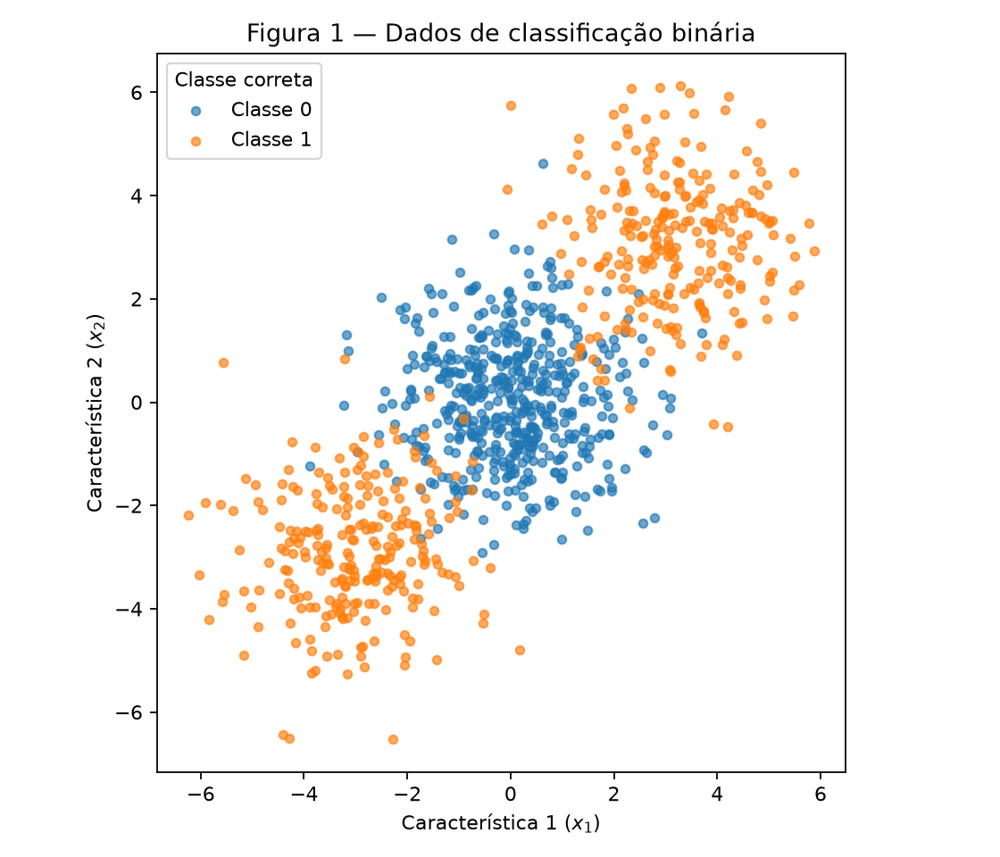
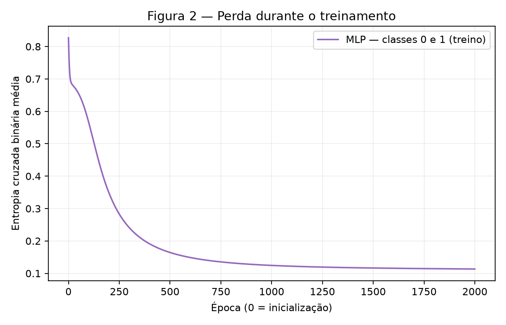
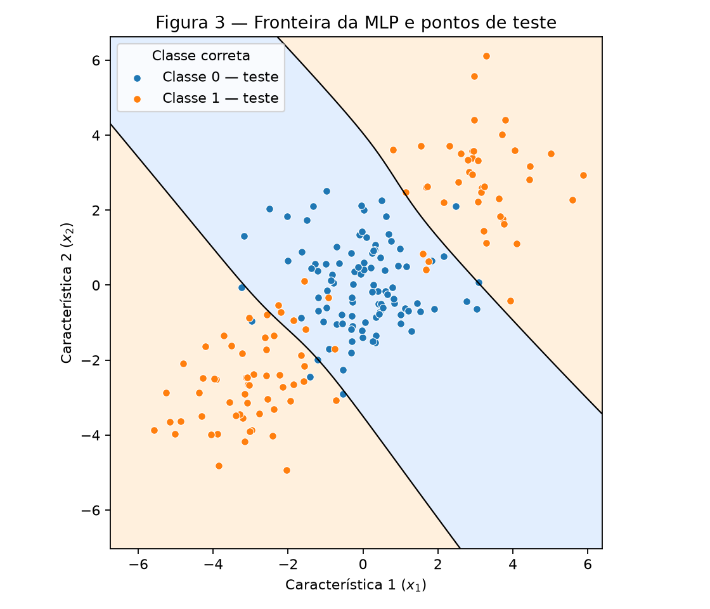

# Exercise: MLP

## Exercise 1

[Notebook do Exercício 1](code/exercicio_1.ipynb)

A rede recebe duas entradas, possui uma camada oculta com dois neurônios e
um neurônio de saída. Cada neurônio calcula uma soma ponderada das entradas
com um bias e aplica a função de ativação $\tanh$.

Os valores fornecidos são:

$$
\mathbf{x} = \begin{bmatrix}0{,}5\\-0{,}2\end{bmatrix},
\qquad y = 1{,}0,
$$

$$
\mathbf{W}^{(1)} =
\begin{bmatrix}0{,}3 & -0{,}1\\0{,}2 & 0{,}4\end{bmatrix},
\qquad
\mathbf{b}^{(1)} = \begin{bmatrix}0{,}1\\-0{,}2\end{bmatrix},
$$

$$
\mathbf{W}^{(2)} = \begin{bmatrix}0{,}5 & -0{,}3\end{bmatrix},
\qquad b^{(2)} = 0{,}2,
\qquad \eta = 0{,}3.
$$

Cada linha de $\mathbf{W}^{(1)}$ contém os pesos de um neurônio oculto.
Os dois neurônios recebem as mesmas entradas, mas usam pesos e biases
próprios. $y$ é o alvo e $\hat y$ será a previsão da rede.

As derivações, substituições e resultados são apresentados a seguir.
Os valores exibidos são arredondados; os cálculos usam a precisão completa.

### A — Forward pass

#### 1. Pré-ativações da camada oculta

A pré-ativação é a soma ponderada antes da função de ativação:

$$
\mathbf{z}^{(1)} = \mathbf{W}^{(1)}\mathbf{x} + \mathbf{b}^{(1)}.
$$

Para o primeiro neurônio:

$$
z_1^{(1)} = 0{,}3\cdot0{,}5 + (-0{,}1)\cdot(-0{,}2) + 0{,}1
= 0{,}1500 + 0{,}0200 + 0{,}1000
= 0{,}2700.
$$

Para o segundo neurônio:

$$
z_2^{(1)} = 0{,}2\cdot0{,}5 + 0{,}4\cdot(-0{,}2) + (-0{,}2)
= 0{,}1000 - 0{,}0800 - 0{,}2000
= -0{,}1800.
$$

Logo, **$\mathbf{z}^{(1)} = [0{,}2700, -0{,}1800]$**.

#### 2. Ativações da camada oculta

Aplicamos a função separadamente a cada pré-ativação:

$$
\mathbf{h}^{(1)} = \tanh(\mathbf{z}^{(1)}),
\qquad \tanh(z) = \frac{e^{2z}-1}{e^{2z}+1}.
$$

Para o primeiro neurônio:

$$
2z_1^{(1)} = 0{,}5400, \qquad e^{0{,}5400}\approx1{,}71600686,
$$

$$
h_1^{(1)} = \frac{e^{0{,}5400}-1}{e^{0{,}5400}+1}
\approx \frac{0{,}71600686}{2{,}71600686}
\approx 0{,}26362484.
$$

Para o segundo neurônio:

$$
2z_2^{(1)} = -0{,}3600, \qquad e^{-0{,}3600}\approx0{,}69767633,
$$

$$
h_2^{(1)} = \frac{e^{-0{,}3600}-1}{e^{-0{,}3600}+1}
\approx \frac{-0{,}30232367}{1{,}69767633}
\approx -0{,}17808087.
$$

Assim, **$\mathbf{h}^{(1)}\approx[0{,}2636, -0{,}1781]$**.
A função preserva os sinais e produz valores entre $-1$ e $1$.
Sua não linearidade permite à rede representar relações mais complexas.

#### 3. Pré-ativação da saída

O neurônio de saída recebe as ativações da camada oculta:

$$
u^{(2)} = \mathbf{W}^{(2)}\mathbf{h}^{(1)} + b^{(2)}
= 0{,}5h_1^{(1)} + (-0{,}3)h_2^{(1)} + 0{,}2.
$$

As contribuições são:

$$
0{,}5h_1^{(1)}\approx0{,}13181242,
\qquad (-0{,}3)h_2^{(1)}\approx0{,}05342426.
$$

A segunda contribuição é positiva, pois o peso e a ativação são negativos.
Somando as contribuições com o bias:

$$
u^{(2)}\approx0{,}13181242 + 0{,}05342426 + 0{,}20000000
= 0{,}38523668.
$$

Portanto, **$u^{(2)}\approx0{,}3852$**.

#### 4. Previsão e perda

A saída também usa $\tanh$:

$$
\hat y = \tanh(u^{(2)}) = \frac{e^{2u^{(2)}}-1}{e^{2u^{(2)}}+1}.
$$

Usando o valor completo de $u^{(2)}$:

$$
2u^{(2)}\approx0{,}77047336,
\qquad e^{2u^{(2)}}\approx2{,}16078883,
$$

$$
\hat y\approx\frac{1{,}16078883}{3{,}16078883}
\approx0{,}36724656.
$$

A **previsão é $\hat y\approx0{,}3672$**, abaixo do alvo $y=1{,}0000$.
Para uma única amostra, $N=1$, o erro quadrático médio é:

$$
L = (y-\hat y)^2.
$$

A diferença e seu quadrado são:

$$
y-\hat y\approx1{,}00000000-0{,}36724656=0{,}63275344,
$$

$$
L\approx(0{,}63275344)^2\approx0{,}40037691.
$$

Logo, **a perda é $L\approx0{,}4004$**. Ela mede a distância quadrática
entre a previsão e o alvo: é não negativa e diminui quando a previsão
se aproxima do alvo. Até aqui, nenhum peso ou bias foi atualizado.

### B — Backward pass

O backward pass percorre os cálculos no sentido inverso para obter as
sensibilidades da perda em relação aos parâmetros. Uma derivada indica
como a perda muda diante de uma pequena mudança em uma variável.

Começamos pela dependência da perda em relação à previsão. Como
$L=(y-\hat y)^2=(\hat y-y)^2$ e o alvo $y$ é constante:

$$
\frac{\partial L}{\partial\hat y}
=2(\hat y-y)\frac{\partial(\hat y-y)}{\partial\hat y}
=2(\hat y-y)\cdot1
=2(\hat y-y).
$$

Usando a previsão calculada no item A:

$$
\frac{\partial L}{\partial\hat y}
\approx 2(0{,}36724656-1{,}00000000)
= 2(-0{,}63275344)
= -1{,}26550688.
$$

Portanto, **$\partial L/\partial\hat y\approx-1{,}2655$**.
O sinal negativo indica que um pequeno aumento na previsão reduz a perda
neste ponto, mantendo o alvo fixo. Isso é coerente com uma previsão de
$0{,}3672$ abaixo do alvo $1{,}0000$.

#### Derivada em relação à pré-ativação da saída

Como $\hat y=\tanh(u^{(2)})$ e $\tanh'(u)=1-\tanh^2(u)$:

$$
\frac{\partial\hat y}{\partial u^{(2)}}=1-\hat y^2.
$$

Aplicando a regra da cadeia:

$$
\frac{\partial L}{\partial u^{(2)}}
=\frac{\partial L}{\partial\hat y}
\frac{\partial\hat y}{\partial u^{(2)}}
=2(\hat y-y)(1-\hat y^2).
$$

Os valores intermediários são:

$$
\hat y^2\approx0{,}13487004,
\qquad 1-\hat y^2\approx0{,}86512996.
$$

Logo:

$$
\frac{\partial L}{\partial u^{(2)}}
\approx(-1{,}26550688)\cdot0{,}86512996
\approx-1{,}09482791.
$$

Portanto, **$\partial L/\partial u^{(2)}\approx-1{,}0948$**.
O fator da tanh mantém o sinal porque $-1<\hat y<1$, portanto
$0<1-\hat y^2\leq1$. Multiplicar por esse fator positivo mantém o sinal
da derivada anterior. Isso vale também para saídas negativas da tanh,
pois o fator usa o quadrado da saída.

#### Gradientes dos pesos e do bias da saída

Escrevendo $u^{(2)}=w_1^{(2)}h_1^{(1)}+w_2^{(2)}h_2^{(1)}+b^{(2)}$, cada peso tem como derivada local a ativação que o multiplica. Para o bias, a derivada local é $1$.

Para o primeiro peso, pela regra da cadeia:

$$
\frac{\partial L}{\partial w_1^{(2)}}
=\frac{\partial L}{\partial u^{(2)}}\frac{\partial u^{(2)}}{\partial w_1^{(2)}}
=\frac{\partial L}{\partial u^{(2)}}h_1^{(1)}
\approx(-1{,}09482791)\cdot0{,}26362484
\approx-0{,}28862383.
$$

Para o segundo peso:

$$
\frac{\partial L}{\partial w_2^{(2)}}
=\frac{\partial L}{\partial u^{(2)}}\frac{\partial u^{(2)}}{\partial w_2^{(2)}}
=\frac{\partial L}{\partial u^{(2)}}h_2^{(1)}
\approx(-1{,}09482791)\cdot(-0{,}17808087)
\approx0{,}19496791.
$$

Para o bias:

$$
\frac{\partial L}{\partial b^{(2)}}
=\frac{\partial L}{\partial u^{(2)}}\frac{\partial u^{(2)}}{\partial b^{(2)}}
=\frac{\partial L}{\partial u^{(2)}}\cdot1
\approx-1{,}09482791.
$$

Assim, **$\partial L/\partial\mathbf{W}^{(2)}\approx[-0{,}2886,0{,}1950]$** e
**$\partial L/\partial b^{(2)}\approx-1{,}0948$**.
Os parâmetros ainda não foram atualizados.

#### Derivadas em relação às ativações ocultas

Como $u^{(2)}=w_1^{(2)}h_1^{(1)}+w_2^{(2)}h_2^{(1)}+b^{(2)}$, as derivadas de $u^{(2)}$ em relação às ativações são os pesos correspondentes:

$$
\frac{\partial u^{(2)}}{\partial h_1^{(1)}}=w_1^{(2)}=0{,}5000,
\qquad
\frac{\partial u^{(2)}}{\partial h_2^{(1)}}=w_2^{(2)}=-0{,}3000.
$$

Pela regra da cadeia:

$$
\frac{\partial L}{\partial h_1^{(1)}}
=\frac{\partial L}{\partial u^{(2)}}w_1^{(2)}
\approx(-1{,}09482791)\cdot0{,}5000
\approx-0{,}54741396,
$$

$$
\frac{\partial L}{\partial h_2^{(1)}}
=\frac{\partial L}{\partial u^{(2)}}w_2^{(2)}
\approx(-1{,}09482791)\cdot(-0{,}3000)
\approx0{,}32844837.
$$

Portanto, **$\partial L/\partial\mathbf{h}^{(1)}\approx[-0{,}5474,0{,}3284]$**.
O peso negativo da segunda ligação inverte o sinal da derivada propagada
por ela.

#### Derivadas em relação às pré-ativações ocultas

Como $h_j^{(1)}=\tanh(z_j^{(1)})$, a derivada local é
$\partial h_j^{(1)}/\partial z_j^{(1)}=1-(h_j^{(1)})^2$.
Pela regra da cadeia:

$$
\frac{\partial L}{\partial z_j^{(1)}}
=\frac{\partial L}{\partial h_j^{(1)}}
\frac{\partial h_j^{(1)}}{\partial z_j^{(1)}}
=\frac{\partial L}{\partial h_j^{(1)}}(1-(h_j^{(1)})^2).
$$

Para o primeiro neurônio, $(h_1^{(1)})^2\approx0{,}06949805$ e
$1-(h_1^{(1)})^2\approx0{,}93050195$. Assim:

$$
\frac{\partial L}{\partial z_1^{(1)}}
\approx(-0{,}54741396)\cdot0{,}93050195
\approx-0{,}50936975.
$$

Para o segundo, $(h_2^{(1)})^2\approx0{,}03171280$ e
$1-(h_2^{(1)})^2\approx0{,}96828720$. Logo:

$$
\frac{\partial L}{\partial z_2^{(1)}}
\approx0{,}32844837\cdot0{,}96828720
\approx0{,}31803236.
$$

Portanto, **$\partial L/\partial\mathbf{z}^{(1)}\approx[-0{,}5094,0{,}3180]$**.
Os fatores positivos da tanh preservam os sinais das derivadas anteriores.

#### Gradientes dos pesos e biases da camada oculta

Cada pré-ativação oculta é uma soma ponderada das entradas:
$z_j^{(1)}=w_{j1}^{(1)}x_1+w_{j2}^{(1)}x_2+b_j^{(1)}$.
Mantendo as entradas fixas, a derivada local em relação a cada peso é
$x_i$ e, em relação ao bias, é $1$. Pela regra da cadeia:

$$
\frac{\partial L}{\partial w_{ji}^{(1)}}
=\frac{\partial L}{\partial z_j^{(1)}}
\frac{\partial z_j^{(1)}}{\partial w_{ji}^{(1)}}
=\frac{\partial L}{\partial z_j^{(1)}}x_i,
$$

$$
\frac{\partial L}{\partial b_j^{(1)}}
=\frac{\partial L}{\partial z_j^{(1)}}
\frac{\partial z_j^{(1)}}{\partial b_j^{(1)}}
=\frac{\partial L}{\partial z_j^{(1)}}\cdot1.
$$

Para cada parâmetro, as substituições são:

| Parâmetro | Substituição do gradiente | Resultado |
|---|---|---|
| $w_{11}^{(1)}$ | $(-0{,}50936975)\cdot0{,}5000$ | $-0{,}25468488\approx-0{,}2547$ |
| $w_{12}^{(1)}$ | $(-0{,}50936975)\cdot(-0{,}2000)$ | $0{,}10187395\approx0{,}1019$ |
| $w_{21}^{(1)}$ | $0{,}31803236\cdot0{,}5000$ | $0{,}15901618\approx0{,}1590$ |
| $w_{22}^{(1)}$ | $0{,}31803236\cdot(-0{,}2000)$ | $-0{,}06360647\approx-0{,}0636$ |
| $b_1^{(1)}$ | $(-0{,}50936975)\cdot1$ | $-0{,}50936975\approx-0{,}5094$ |
| $b_2^{(1)}$ | $0{,}31803236\cdot1$ | $0{,}31803236\approx0{,}3180$ |

Portanto:

$$
\frac{\partial L}{\partial\mathbf{W}^{(1)}}\approx
\begin{bmatrix}-0{,}2547 & 0{,}1019\\0{,}1590 & -0{,}0636\end{bmatrix},
\qquad
\frac{\partial L}{\partial\mathbf{b}^{(1)}}\approx
\begin{bmatrix}-0{,}5094\\0{,}3180\end{bmatrix}.
$$


### C — Parameter update

Para cada parâmetro $\theta$, foi aplicada a regra:

$$
\theta_{\mathrm{novo}}=\theta_{\mathrm{atual}}-\eta\frac{\partial L}{\partial\theta},
\qquad \eta=0{,}3.
$$

Um gradiente positivo faz o parâmetro diminuir; um gradiente negativo faz
o parâmetro aumentar. As atualizações usaram os gradientes calculados
com os valores originais. A nova perda foi verificada com outro forward pass.

Embora o enunciado mencione oito parâmetros, os valores fornecidos definem
nove: quatro pesos e dois biases ocultos, dois pesos de saída e um bias de
saída. Foram atualizados todos os nove.

As substituições abaixo usam os gradientes do item B. Os números exibidos
estão arredondados; o código mantém a precisão completa.

| Parâmetro | Valor atual | Substituição | Novo valor |
|---|---|---|---|
| $w_{11}^{(1)}$ | $0{,}3000$ | $0{,}3000-0{,}3(-0{,}25468488)$ | $0{,}37640546\approx0{,}3764$ |
| $w_{12}^{(1)}$ | $-0{,}1000$ | $-0{,}1000-0{,}3(0{,}10187395)$ | $-0{,}13056219\approx-0{,}1306$ |
| $w_{21}^{(1)}$ | $0{,}2000$ | $0{,}2000-0{,}3(0{,}15901618)$ | $0{,}15229515\approx0{,}1523$ |
| $w_{22}^{(1)}$ | $0{,}4000$ | $0{,}4000-0{,}3(-0{,}06360647)$ | $0{,}41908194\approx0{,}4191$ |
| $b_1^{(1)}$ | $0{,}1000$ | $0{,}1000-0{,}3(-0{,}50936975)$ | $0{,}25281093\approx0{,}2528$ |
| $b_2^{(1)}$ | $-0{,}2000$ | $-0{,}2000-0{,}3(0{,}31803236)$ | $-0{,}29540971\approx-0{,}2954$ |
| $w_1^{(2)}$ | $0{,}5000$ | $0{,}5000-0{,}3(-0{,}28862383)$ | $0{,}58658715\approx0{,}5866$ |
| $w_2^{(2)}$ | $-0{,}3000$ | $-0{,}3000-0{,}3(0{,}19496791)$ | $-0{,}35849037\approx-0{,}3585$ |
| $b^{(2)}$ | $0{,}2000$ | $0{,}2000-0{,}3(-1{,}09482791)$ | $0{,}52844837\approx0{,}5284$ |

Logo, os parâmetros atualizados são:

$$
\mathbf{W}_{\mathrm{novo}}^{(1)}\approx
\begin{bmatrix}0{,}3764&-0{,}1306\\0{,}1523&0{,}4191\end{bmatrix},
\qquad
\mathbf{b}_{\mathrm{novo}}^{(1)}\approx\begin{bmatrix}0{,}2528\\-0{,}2954\end{bmatrix},
$$

$$
\mathbf{W}_{\mathrm{novo}}^{(2)}\approx[0{,}5866,-0{,}3585],
\qquad b_{\mathrm{novo}}^{(2)}\approx0{,}5284.
$$

#### Segundo forward pass e direção da mudança da perda

Com os novos parâmetros, mantendo a mesma entrada e o mesmo alvo:

$$
z_{1,\mathrm{novo}}^{(1)}
\approx0{,}37640546\cdot0{,}5000
+(-0{,}13056219)\cdot(-0{,}2000)+0{,}25281093
\approx0{,}46712609,
$$

$$
z_{2,\mathrm{novo}}^{(1)}
\approx0{,}15229515\cdot0{,}5000
+0{,}41908194\cdot(-0{,}2000)-0{,}29540971
\approx-0{,}30307852.
$$

As exponenciais e ativações precisam ser recalculadas:

$$
e^{2z_{1,\mathrm{novo}}^{(1)}}\approx2{,}54530933,
\qquad
h_{1,\mathrm{novo}}^{(1)}
\approx\frac{2{,}54530933-1}{2{,}54530933+1}
\approx0{,}43587433,
$$

$$
e^{2z_{2,\mathrm{novo}}^{(1)}}\approx0{,}54544296,
\qquad
h_{2,\mathrm{novo}}^{(1)}
\approx\frac{0{,}54544296-1}{0{,}54544296+1}
\approx-0{,}29412735.
$$

As contribuições para a saída são aproximadamente $0{,}25567828$ e
$0{,}10544182$. Logo:

$$
u_{\mathrm{novo}}^{(2)}
\approx0{,}25567828+0{,}10544182+0{,}52844837
\approx0{,}88956848.
$$

Como $e^{2u_{\mathrm{novo}}^{(2)}}\approx5{,}92474090$:

$$
\hat y_{\mathrm{novo}}
\approx\frac{5{,}92474090-1}{5{,}92474090+1}
\approx0{,}71118053,
$$

$$
L_{\mathrm{novo}}=(y-\hat y_{\mathrm{novo}})^2
\approx(1{,}00000000-0{,}71118053)^2
\approx0{,}08341669.
$$

**A perda diminui na segunda passagem: de $0{,}4004$ para $0{,}0834$.**
A previsão passou de $0{,}3672$ para $0{,}7112$, ficando mais próxima do
alvo $1{,}0000$. O ajuste foi feito no sentido contrário ao gradiente;
para este passo com $\eta=0{,}3$, a verificação numérica confirma a redução.

## Exercise 2

[Notebook do Exercício 2](code/exercicio_2.ipynb)

### A — Generate the data

Foram geradas **1000 amostras com duas características**, usando os parâmetros do enunciado sem alterações. Os três grupos têm centros `[0, 0]`, `[3, 3]` e `[-3, -3]`, respectivamente, com 500, 250 e 250 amostras e desvio padrão `1.2`.

A expressão `y = (c > 0).astype(int)` mantém o grupo central na classe 0 e reúne os dois grupos afastados na classe 1. Assim, cada classe tem **500 amostras**.

A divisão usa `test_size=0.2`, `random_state=42` e `stratify=y`: **800 pontos no treino (400 de cada classe)** e **200 no teste (100 de cada classe)**. O teste foi reservado para a avaliação final. As características foram usadas na escala original; não houve ajuste de pré-processamento usando o teste.

A semente dos dados e da divisão é 42. O objeto `rng = np.random.default_rng(42)` é usado na inicialização dos pesos da rede.



**Figura 1** — Os 1000 pontos, com os grupos central e afastados identificados pelas duas classes.

### B — Establish the baseline

A regressão logística foi ajustada apenas nos dados de treino, com `max_iter=1000` e `random_state=42`. Sua saída depende de uma combinação linear das duas características, portanto sua fronteira de decisão é uma reta.

A **acurácia no teste foi de 47,5%**, equivalente a **95 acertos em 200 amostras**. Esse resultado será comparado com a MLP.

### C — Implement the MLP

A MLP foi implementada em NumPy com os tamanhos das camadas como argumento. Foi usada a arquitetura **2 → 8 → 1**, com uma camada oculta de oito neurônios `tanh` e uma saída `sigmoid`. Os biases começam em zero e os pesos usam inicialização de Xavier, com desvio padrão $\sqrt{2/(n_{\mathrm{entrada}}+n_{\mathrm{saída}})}$.

| Configuração | Valor |
|---|---|
| Arquitetura | 2 entradas, 8 neurônios ocultos, 1 saída |
| Parâmetros treináveis | 33 |
| Ativação oculta | tanh |
| Ativação de saída | sigmoid |
| Perda | Entropia cruzada binária média |
| Taxa de aprendizado | 0,1 |
| Épocas | 2000 |
| Lote | Todas as 800 amostras de treino |
| Inicialização | Xavier, `rng` com semente 42 |
| Limiar de classificação | 0,5 |

Essas configurações foram definidas antes da avaliação do teste. A acurácia é calculada diretamente como a proporção de previsões corretas.

#### Forward pass e perda

Neste exercício, as amostras são organizadas nas **linhas** das matrizes. Para cada camada $\ell$, os pesos têm dimensão entrada × saída e o bias é somado a cada amostra:

$$
\mathbf{A}^{(0)}=\mathbf{X},\qquad
\mathbf{Z}^{(\ell)}=\mathbf{A}^{(\ell-1)}\mathbf{W}^{(\ell)}+\mathbf{b}^{(\ell)}.
$$

Nas camadas ocultas, $\mathbf{A}^{(\ell)}=\tanh(\mathbf{Z}^{(\ell)})$.
Na saída binária, cada logit $u_i$ é convertido em probabilidade:

$$
p_i=\sigma(u_i)=\frac{1}{1+e^{-u_i}}.
$$

A perda média é:

$$
L=-\frac{1}{N}\sum_{i=1}^{N}\left[y_i\log(p_i)+(1-y_i)\log(1-p_i)\right].
$$

No código, a mesma perda é calculada pela expressão equivalente
$\frac{1}{N}\sum_i[\log(1+e^{u_i})-y_i u_i]$, usando `np.logaddexp(0, u)` para evitar problemas numéricos nas exponenciais e em `log(0)`.

#### Backward pass

Para cada probabilidade:

$$
\frac{\partial L}{\partial p_i}
=\frac{1}{N}\left[-\frac{y_i}{p_i}+\frac{1-y_i}{1-p_i}\right]
=\frac{p_i-y_i}{Np_i(1-p_i)}.
$$

Como $\partial p_i/\partial u_i=p_i(1-p_i)$, a regra da cadeia resulta em:

$$
\frac{\partial L}{\partial u_i}
=\frac{p_i-y_i}{Np_i(1-p_i)}p_i(1-p_i)
=\frac{p_i-y_i}{N}.
$$

Chamando a derivada em relação às pré-ativações de $\mathbf{\Delta}^{(\ell)}$, na última camada:

$$
\mathbf{\Delta}^{(L)}=\frac{\mathbf{P}-\mathbf{Y}}{N}.
$$

Para qualquer camada, os gradientes são:

$$
\frac{\partial L}{\partial\mathbf{W}^{(\ell)}}
=(\mathbf{A}^{(\ell-1)})^T\mathbf{\Delta}^{(\ell)},\qquad
\frac{\partial L}{\partial\mathbf{b}^{(\ell)}}
=\sum_{i=1}^{N}\mathbf{\Delta}_{i,:}^{(\ell)}.
$$

Para propagar a derivada à camada oculta anterior:

$$
\mathbf{\Delta}^{(\ell-1)}
=\left[\mathbf{\Delta}^{(\ell)}(\mathbf{W}^{(\ell)})^T\right]
\odot\left[1-(\mathbf{A}^{(\ell-1)})^2\right],
$$

onde $\odot$ indica multiplicação elemento a elemento. A divisão por $N$ aparece uma única vez, na derivada da saída.

#### Atualização e resultados

Todos os gradientes são calculados antes de atualizar os parâmetros:

$$
\mathbf{W}^{(\ell)}\leftarrow\mathbf{W}^{(\ell)}-\eta\frac{\partial L}{\partial\mathbf{W}^{(\ell)}},\qquad
\mathbf{b}^{(\ell)}\leftarrow\mathbf{b}^{(\ell)}-\eta\frac{\partial L}{\partial\mathbf{b}^{(\ell)}}.
$$

O treino registrou a perda inicial e a perda após cada atualização. Ela caiu de **0,8270 para 0,1134**. A MLP obteve **91,5% de acurácia no teste**, com **183 acertos em 200 pontos** — **44 pontos percentuais** acima do baseline.

A ativação da saída e a função que retorna a perda e sua derivada são argumentos da classe. Assim, os métodos `forward`, `backward` e `update` podem ser reutilizados com outros tamanhos de camadas e outras saídas.




**Figura 2** — Perda no treino desde a inicialização até a época 2000.



**Figura 3** — O fundo representa as classes previstas pela rede; os pontos mostram as classes corretas das 200 amostras de teste. A linha preta marca probabilidade 0,5.

#### Código executável

Implementação da MLP:

```python
--8<-- "docs/exercises/mlp/code/mlp.py"
```

Geração dos dados, baseline, treinamento e gráficos:

```python
--8<-- "docs/exercises/mlp/code/exercicio_2.py"
```

Para reproduzir a partir da raiz do repositório:

```powershell
python -m pip install -r requirements.txt
python docs/exercises/mlp/code/exercicio_2.py
```

### D — Analysis

Na Figura 3, a classe 0 ocupa uma **faixa central**, enquanto a classe 1 ocupa **duas regiões em lados opostos dessa faixa**. A MLP aprendeu duas fronteiras aproximadamente paralelas, com pequenas variações na forma, para manter o grupo central separado dos dois grupos afastados.

Uma única reta divide o plano em dois semiplanos. Ela não consegue colocar os dois grupos opostos da classe 1 de um lado e o grupo central da classe 0 do outro. A camada oculta combina várias transformações não lineares, permitindo atribuir a mesma classe às duas regiões afastadas.

Além disso, a classe 1 foi construída com dois grupos em torno de centros opostos, enquanto a classe 0 fica perto da origem. As médias das classes ficam próximas, e a regressão logística não representa a diferença entre estar no centro e estar afastado em qualquer uma das duas direções. Seu resultado de **47,5%** fica próximo do patamar de 50% de um palpite aleatório em classes balanceadas; o valor abaixo de 50% neste teste é compatível com a variação da amostra e com o ajuste de uma fronteira inadequada para essa estrutura.

A MLP alcançou **91,5%** porque sua fronteira acompanha a organização dos grupos. Os **17 erros** restantes aparecem em um conjunto com sobreposição entre as classes, especialmente próximo às fronteiras. A melhoria foi medida no teste, que não participou do treinamento.


## Results summary

| # | Quantity | Value |
|---|---|---|
| 1 | Ex. 1 — $\mathbf{z}^{(1)}$ e $\mathbf{h}^{(1)}$ | $\mathbf{z}^{(1)}=[0{,}2700,-0{,}1800]$; $\mathbf{h}^{(1)}\approx[0{,}2636,-0{,}1781]$ |
| 2 | Ex. 1 — $u^{(2)}$, $\hat y$ e $L$ | $u^{(2)}\approx0{,}3852$; $\hat y\approx0{,}3672$; $L\approx0{,}4004$ |
| 3 | Ex. 1 — parâmetros após a atualização | $\mathbf{W}^{(1)}\approx[[0{,}3764,-0{,}1306],[0{,}1523,0{,}4191]]$; $\mathbf{b}^{(1)}\approx[0{,}2528,-0{,}2954]$; $\mathbf{W}^{(2)}\approx[0{,}5866,-0{,}3585]$; $b^{(2)}\approx0{,}5284$ |
| 4 | Ex. 2 — acurácia do baseline linear no teste | 47,5% (95/200) |
| 5 | Ex. 2 — arquitetura e acurácia no teste | 2 → 8 → 1; 91,5% (183/200) |
