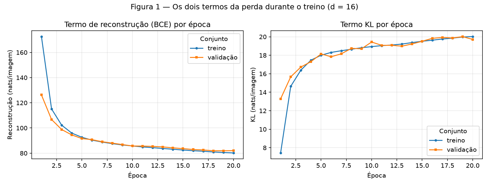
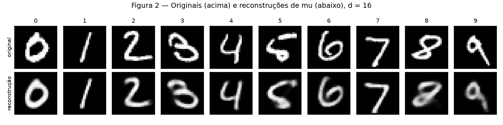
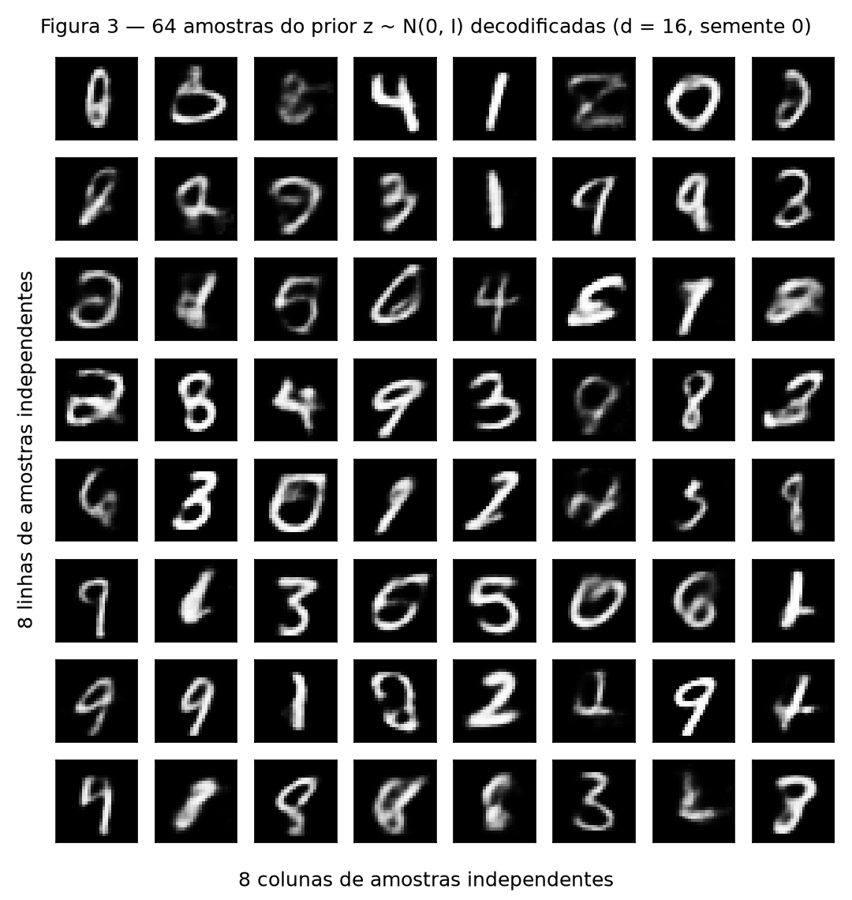
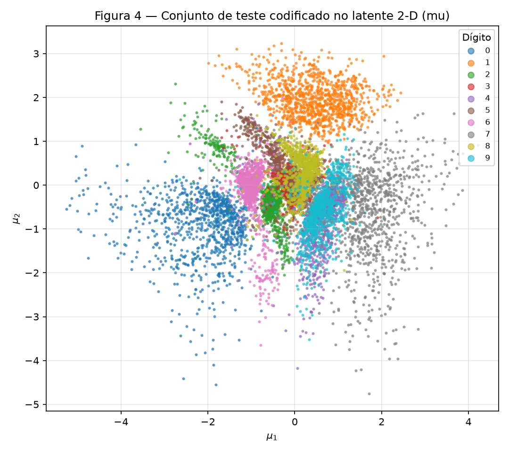
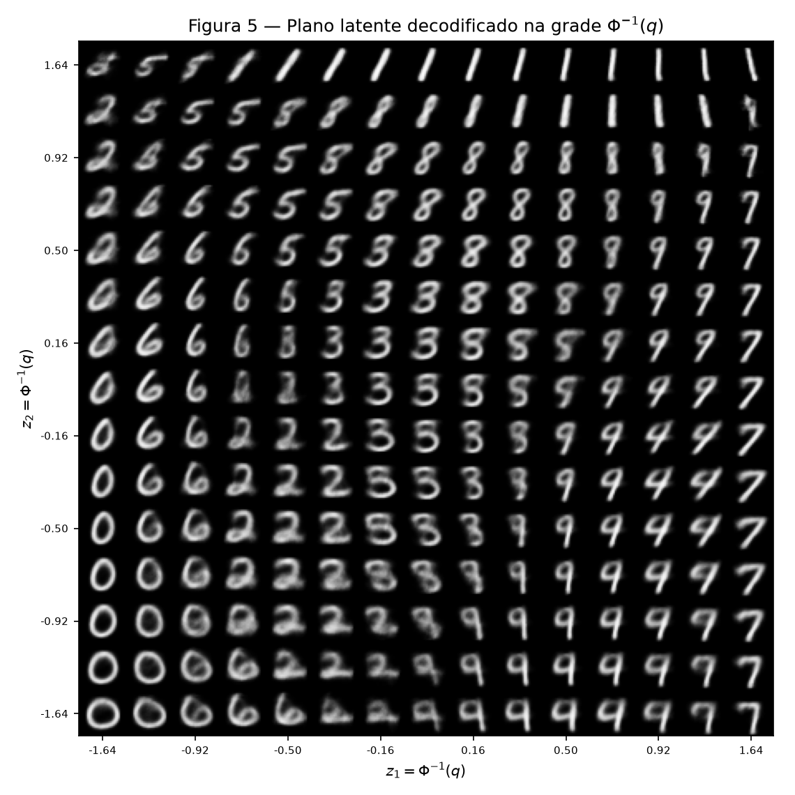
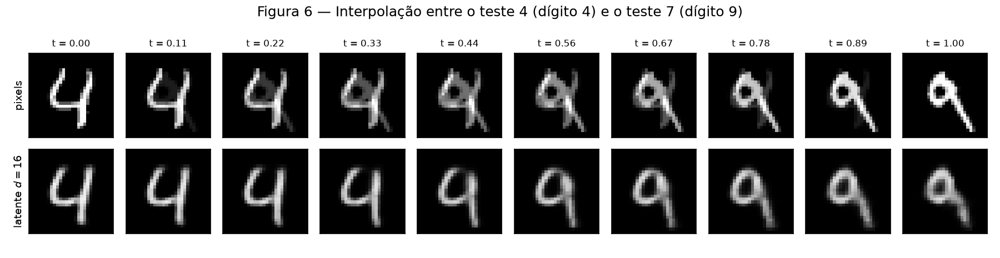

# Exercise: VAE

## Exercise 1

### A — Load and split the data

Carreguei o MNIST pelo `torchvision` com `transforms.ToTensor()`, que já coloca os
pixels entre 0 e 1, e achatei cada imagem em um vetor de 784 posições. Dividi as
60 000 imagens de treino em 50 000 para treino e 10 000 para validação, com o
gerador de semente 42 do enunciado. As 10 000 imagens oficiais de teste formam o
conjunto de teste.

```python
train_full = datasets.MNIST("data", train=True, download=True, transform=transforms.ToTensor())
test = datasets.MNIST("data", train=False, download=True, transform=transforms.ToTensor())
train, val = random_split(train_full, [50_000, 10_000],
                          generator=torch.Generator().manual_seed(42))
```

O teste não participou de nenhuma decisão: ele só é percorrido depois da última
época.

Na primeira execução o treino ficou muito mais lento do que o meio minuto previsto
no enunciado. Investigando, o gargalo não era o VAE: o `datasets.MNIST` aplica o
`ToTensor()` imagem por imagem a cada acesso do `DataLoader`, então a conversão das
50 000 imagens PIL se repetia em todas as épocas. Passei a converter os dados para
tensores uma única vez antes do treino. A ordem dos exemplos não muda, então os
lotes continuam exatamente os mesmos, e o tempo caiu bastante.

### B — Build the model

Usei a arquitetura do enunciado, com $d = 16$:

| Parte | Camadas |
|---|---|
| Encoder | $784 \to 512 \to 256$, ReLU depois de cada uma |
| Cabeças | duas camadas lineares $256 \to 16$, uma para $\boldsymbol{\mu}$ e outra para $\log \boldsymbol{\sigma}^2$ |
| Decoder | $16 \to 256 \to 512 \to 784$, ReLU nas ocultas e sigmoid na saída |

São 1 079 600 parâmetros treináveis. A segunda cabeça prevê $\log \sigma_i^2$ e não
$\sigma_i$ porque o log pode assumir qualquer valor real: ao passar por
$\sigma_i^2 = e^{\log \sigma_i^2}$, a variância sai positiva sem precisar de
restrição adicional.

#### Reparametrização

O encoder não devolve um ponto, e sim uma gaussiana
$q(z \mid x) = \mathcal{N}(\boldsymbol{\mu}, \boldsymbol{\sigma}^2 I)$. Amostrar
$z$ diretamente dessa distribuição interromperia o gradiente, porque o sorteio não
é uma função derivável de $\boldsymbol{\mu}$ e $\boldsymbol{\sigma}$. A
reparametrização reescreve a amostra como uma conta determinística somada a um
ruído que vem de fora:

$$
z = \boldsymbol{\mu} + \boldsymbol{\sigma} \odot \boldsymbol{\varepsilon},
\qquad \boldsymbol{\varepsilon} \sim \mathcal{N}(0, I),
\qquad \boldsymbol{\sigma} = \exp\!\left(\tfrac{1}{2}\log \boldsymbol{\sigma}^2\right).
$$

Com isso $\partial z / \partial \boldsymbol{\mu} = 1$ e
$\partial z / \partial \boldsymbol{\sigma} = \boldsymbol{\varepsilon}$, e o
gradiente atravessa a amostragem até o encoder.

```python
@staticmethod
def reparameterize(mu, logvar):
    sigma = torch.exp(0.5 * logvar)
    eps = torch.randn_like(sigma)
    return mu + sigma * eps
```

#### A perda

Por imagem, somando nos pixels e nas dimensões latentes:

$$
L = \underbrace{-\sum_{j=1}^{784} \Big[x_j \log \hat{x}_j + (1 - x_j) \log (1 - \hat{x}_j)\Big]}_{\text{reconstrução (BCE)}}
\;+\; \beta \cdot \underbrace{\tfrac{1}{2}\sum_{i=1}^{16} \left(\mu_i^2 + \sigma_i^2 - 1 - \log \sigma_i^2\right)}_{\text{KL}}
$$

com $\beta = 1$, tirando a média sobre as imagens do lote.

O termo de reconstrução é o $-\log p(x \mid z)$ sob uma verossimilhança de
Bernoulli por pixel, que é o que a saída sigmoid representa: cada $\hat{x}_j$ é a
probabilidade de o pixel $j$ estar aceso. Como os pixels do MNIST são quase todos 0
ou 1, essa suposição se ajusta bem. Na implementação isso é
`F.binary_cross_entropy(x_hat, x, reduction="sum")` dividido pelo tamanho do lote.
O `reduction="mean"` dividiria também pelos 784 pixels e deixaria a reconstrução
784 vezes menor que o KL, o que equivaleria a usar $\beta \approx 784$ sem
perceber.

O KL é a forma fechada entre duas gaussianas diagonais, escrita termo a termo com
$\sigma_i^2 = e^{\log \sigma_i^2}$:

```python
def kl_term(mu, logvar):
    sigma_sq = torch.exp(logvar)
    per_dim = mu.pow(2) + sigma_sq - 1.0 - logvar
    return 0.5 * per_dim.sum() / mu.size(0)
```

### C — Train

| Configuração | Valor |
|---|---|
| Otimizador | Adam |
| Taxa de aprendizado | $10^{-3}$ |
| Tamanho do lote | 128 |
| Épocas | 20 |
| $\beta$ | 1 |
| Dimensão latente | 16 |
| Semente | 42, antes de construir o modelo |

Ao fim de cada época registrei os dois termos no treino (média da época) e na
validação. Alguns pontos do histórico, em nats por imagem:

| Época | Rec. treino | KL treino | Rec. validação | KL validação |
|---|---|---|---|---|
| 1 | 172,624 | 7,438 | 126,259 | 13,289 |
| 5 | 92,612 | 18,002 | 91,610 | 18,139 |
| 10 | 85,731 | 18,935 | 85,707 | 19,432 |
| 15 | 82,487 | 19,516 | 83,591 | 19,514 |
| 20 | 80,177 | 20,026 | 81,988 | 19,712 |

A primeira linha chama atenção porque a reconstrução de treino aparece pior que a
de validação. Isso acontece porque a de treino é a média da época inteira,
incluindo os primeiros lotes com o modelo ainda quase não treinado, enquanto a
validação só é medida no fim da época.

Números finais no teste, com $d = 16$:

| Termo | Valor (nats/imagem) |
|---|---|
| Reconstrução | **81,326** |
| KL | **19,797** |
| Soma (ELBO negativo) | **101,122** |

Os valores ficaram próximos da referência do enunciado, 81 e 20. As curvas de
treino e validação acompanharam uma à outra nos dois termos, sem sinal de
sobreajuste nessas 20 épocas.



**Figura 1** — Reconstrução por época à esquerda e KL por época à direita, cada um
com a curva de treino e a de validação. A reconstrução cai de 172,6 para 80,2 nats
no treino, enquanto o KL sobe de 7,4 para 20,0.

### D — Reconstructions and samples



**Figura 2** — Na linha de cima, a primeira imagem de teste de cada dígito de 0 a 9
(índices 3, 2, 1, 18, 4, 8, 11, 0, 61 e 7). Na de baixo, a reconstrução obtida
decodificando $\boldsymbol{\mu}$, sem amostrar $z$. Os dez dígitos continuam
legíveis, e o que se perde são detalhes finos do traço, como a espessura irregular
do 8 e o fechamento do laço do 9.



**Figura 3** — Grade $8 \times 8$ decodificada a partir de
$z \sim \mathcal{N}(0, I)$, sorteados depois de `torch.manual_seed(0)`. A maioria é
reconhecível como dígito, mas várias saíram mais borradas que as reconstruções da
Figura 2, e algumas não são dígito nenhum, como a terceira imagem da primeira linha
e a sexta da quinta linha, que ficam no meio do caminho entre formas diferentes.

### E — Analysis

#### 1. Por que o KL sobe nas primeiras épocas, se a perda total está caindo?

Esse foi o comportamento menos intuitivo da Figura 1: o KL começa baixo, com 7,4
nats na média da primeira época, e sobe até estabilizar perto de 20.

A explicação é que informação custa KL, e no começo ela está barata. Na
inicialização o encoder produz $\boldsymbol{\mu} \approx 0$ e
$\log \boldsymbol{\sigma}^2 \approx 0$, ou seja, $q(z \mid x)$ é quase igual ao
prior. Isso deixa o KL próximo de zero, mas também significa que o $z$ quase não
informa qual imagem está sendo reconstruída, o que explica a reconstrução de 172,6
nats na primeira época.

O KL é exatamente o preço de afastar a posterior de uma imagem do prior, e esse
afastamento é a única forma de o encoder dizer ao decoder com qual imagem ele está
lidando. Como o otimizador minimiza a soma, e não cada termo isoladamente, vale a
pena pagar KL enquanto cada nat gasto ali comprar mais de um nat de reconstrução.
Foi o que aconteceu: entre a primeira e a última época o KL subiu 12,6 nats (de 7,4
para 20,0) e a reconstrução caiu 92,4 nats (de 172,6 para 80,2), um saldo de quase
80 nats a favor.

A subida perde força e a curva achata perto de 20 nats quando a troca deixa de
compensar: no equilíbrio, o próximo nat de KL compraria apenas um nat de
reconstrução, e a soma para de cair.

#### 2. Duas razões para a Figura 3 ficar pior que a Figura 2

**Onde as amostras do prior caem no espaço latente.** O KL puxa cada
$q(z \mid x)$ para perto de $\mathcal{N}(0, I)$, mas com $\beta = 1$ essa pressão é
limitada, tanto que restam 19,8 nats por imagem e não zero. O resultado é que a
mistura de todas as posteriores só se parece aproximadamente com o prior: sobram
buracos e regiões de baixa densidade onde nenhuma imagem de treino foi codificada.
Um $z$ sorteado de $\mathcal{N}(0, I)$ pode cair em um desses vazios, e ali o
decoder nunca foi treinado, então ele extrapola e produz uma forma que não é
dígito. Na Figura 2 isso não ocorre, porque $z = \boldsymbol{\mu}$ é, por
construção, um ponto que o encoder produziu para uma imagem real.

**O que o decoder devolve para um dado $z$.** A saída não é uma imagem sorteada, e
sim a média da Bernoulli pixel a pixel, isto é, $\mathbb{E}[x \mid z]$. Se um mesmo
$z$ é compatível com várias imagens plausíveis (o mesmo 4 com o traço um pouco mais
à esquerda ou à direita, ou um 4 e um 9 com a mesma inclinação), a previsão que
minimiza a BCE é a média pixel a pixel de todas elas. E a média de imagens nítidas
em posições ligeiramente diferentes é uma imagem borrada. O borrão não é falha de
treino, é o que a perda pede. Na Figura 2 o $z$ está ligado a uma imagem específica,
então o conjunto de imagens compatíveis é mais estreito e a média sai mais nítida;
um $z$ do prior costuma cair em uma posição mais ambígua, e a média sai mais
lavada.

#### 3. Por que decodificar a média e não um z amostrado na Figura 2?

Porque $\boldsymbol{\mu}$ é a melhor estimativa pontual que o encoder tem daquela
imagem específica, o centro de $q(z \mid x)$, enquanto
$z = \boldsymbol{\mu} + \boldsymbol{\sigma} \odot \boldsymbol{\varepsilon}$ soma a
isso um ruído que não carrega informação sobre a imagem. O objetivo da Figura 2 é
mostrar quanto do dígito sobrevive ao gargalo $784 \to 16 \to 784$; amostrar $z$
misturaria essa perda com a variação aleatória do sorteio, e a figura mudaria a cada
execução. Decodificar $\boldsymbol{\mu}$ isola o efeito do gargalo e ainda deixa a
figura determinística. O sorteio é necessário no treino, onde ele é o estimador do
ELBO e ensina o decoder a dar conta de uma vizinhança inteira de $z$, mas não na
hora de inspecionar uma reconstrução.

### Código do Exercício 1

Implementação do VAE, da perda e do laço de treino:

```python
--8<-- "docs/exercises/vae/code/vae.py"
```

Treino com $d = 16$, números de teste e Figuras 1 a 3:

```python
--8<-- "docs/exercises/vae/code/exercicio_1.py"
```

Para reproduzir a partir da raiz do repositório:

```powershell
python -m pip install -r requirements.txt
python docs/exercises/vae/code/exercicio_1.py
```

## Exercise 2

### A — Train a 2-D VAE

É o mesmo modelo do Exercício 1, mudando apenas o $d$ de 16 para 2. Mesmos dados,
mesma divisão, mesma semente, $\beta = 1$, Adam com $10^{-3}$, lotes de 128 e 20
épocas.

| Termo (teste) | $d = 16$ | $d = 2$ | Diferença |
|---|---|---|---|
| Reconstrução | **81,326** | **135,748** | +54,42 |
| KL | **19,797** | **6,495** | −13,30 |
| Soma (ELBO negativo) | **101,122** | **142,242** | +41,12 |

Os dois valores ficaram na faixa indicada no enunciado, 135 e 7. O que chama
atenção é que o KL também diminuiu, o que à primeira vista pareceria uma melhora.
Na verdade indica o contrário: o KL é o canal pelo qual a informação sobre a imagem
chega ao decoder, e com $d = 2$ esse canal tem duas vias em vez de dezesseis. O
modelo não consegue pagar mais KL mesmo que isso fosse vantajoso. O que não passa
pelo canal acaba sendo pago na reconstrução, 54,4 nats a mais por imagem. Na soma,
o $d = 2$ custa 41,1 nats a mais.

### B — The encoded test set



**Figura 4** — $\boldsymbol{\mu}$ das 10 000 imagens de teste, uma cor por dígito.
Os dígitos de forma mais característica ficaram com território próprio: o 0 (azul)
à esquerda, o 1 (laranja) na parte de cima e o 7 (cinza) à direita. No miolo as
nuvens se misturam, e o 4 (roxo) quase não aparece, coberto pelo 9 (ciano) e pelo
7, na região em que $\mu_1$ fica entre 0,5 e 2 e $\mu_2$ entre −2 e 0.

### C — The decoded plane



**Figura 5** — Grade $15 \times 15$ de pontos latentes decodificados e dispostos no
mesmo arranjo. As coordenadas não são igualmente espaçadas em $z$: são
$z = \Phi^{-1}(q)$, com $q$ em 15 valores igualmente espaçados entre 0,05 e 0,95.

Esse espaçamento dá a cada célula a mesma massa do prior porque $\Phi^{-1}$ é a
inversa da CDF da $\mathcal{N}(0, 1)$: espaçando uniformemente em $q$, que é
probabilidade acumulada, e convertendo para $z$ só depois, o intervalo entre dois
pontos vizinhos contém sempre a mesma fração do prior ($1/14$ do intervalo de
probabilidade, em cada eixo). Uma grade linear em $z$ faria o oposto, amostrando
demais as caudas e de menos o centro.

O mapa confirma o que a Figura 4 já mostrava: 0 no canto inferior esquerdo, 6 na
faixa da esquerda, 1 na parte de cima à direita, 7 na coluna da direita, 9 e 4 na
faixa inferior direita, e o grupo 3 / 5 / 8 no centro superior.

### D — Interpolation

Escolhi duas imagens de teste de dígitos diferentes: o índice **4**, que é um 4, e o
índice **7**, que é um 9. Peguei justamente esse par por ser o que mais se sobrepõe
na Figura 4.



**Figura 6** — Dez passos de $t = 0$ a $t = 1$. Em cima, no espaço de pixels:
$(1 - t)\,\mathbf{x}_a + t\,\mathbf{x}_b$. Embaixo, no espaço latente do modelo
$d = 16$ do Exercício 1: decodificação de
$(1 - t)\,\boldsymbol{\mu}_a + t\,\boldsymbol{\mu}_b$.

### E — Analysis

#### 1. Quais dígitos se sobrepõem na Figura 4, e a mesma transição na Figura 5

O par com maior sobreposição é 4 e 9. Na Figura 4 a nuvem roxa do 4 quase não
aparece, porque está coberta pela nuvem ciano do 9, em torno de $\mu_1$ entre 0,5 e
2 e $\mu_2$ entre −2 e 0.

Como essa leitura visual é subjetiva, resolvi medir. Ajustei um k-NN com $k = 25$
nos $\boldsymbol{\mu}$ de treino e apliquei nos de teste: a acurácia no latente 2-D
foi de **77,72%**, e o par 4 ↔ 9 responde por **667 confusões**, mais que o dobro do
segundo colocado, 3 ↔ 5 com 317, seguido de 3 ↔ 8 com 260 e 5 ↔ 8 com 234.

Essa mesma transição aparece na metade direita da Figura 5, na faixa de $z_2$ entre
−0,2 e −0,9, percorrendo $z_1$ de cerca de 0,5 até 1,6. As imagens intermediárias
têm o laço superior do 9 entreaberto sobre um traço vertical: o círculo fechado do 9
vai se abrindo até virar o ângulo do 4, e um pouco mais à direita o traço endireita
e vira 7. Nenhuma delas é claramente um dígito ou o outro, que é a mesma ambiguidade
que faz as duas nuvens ocuparem o mesmo pedaço do plano na Figura 4. O grupo
3 / 5 / 8 repete o padrão no centro superior da Figura 5, onde o 3 fecha a barriga e
vira 8.

#### 2. O que duas dimensões obrigam o modelo a descartar

A reconstrução piora de 81,3 para 135,7 nats por imagem, 54,4 nats a mais, 67% pior.
Dois números por imagem precisam codificar ao mesmo tempo qual é o dígito e como ele
foi escrito: inclinação, espessura, tamanho do laço, comprimento do traço. Não há
espaço para tudo isso, e o que é descartado é a variação de estilo dentro de cada
classe.

A Figura 5 serve de evidência. O plano inteiro guarda aproximadamente uma versão de
cada dígito: classificando as 225 células da grade com o mesmo k-NN, os dez dígitos
aparecem em quantidades parecidas, de 13 células para o 0 a 28 para o 8, cerca de 22
em média. Cada dígito recebe um protótipo e uma vizinhança estreita em volta dele, e
sair dessa vizinhança não leva a outro jeito de escrever o mesmo dígito, leva a outro
dígito. Em nenhum ponto do plano aparecem, em lugares distintos, um 7 com corte e
outro sem, ou um 1 em pé e outro inclinado.

Como o decoder recebe apenas a posição no plano, ele devolve $\mathbb{E}[x \mid z]$
sobre todos os estilos que foram comprimidos naquele ponto, que é um protótipo
borrado da classe. Esse borrão corresponde aos 54,4 nats extras de BCE. Visto assim,
o KL menor do $d = 2$ não é economia, e sim o sintoma de que restaram apenas dois
canais para transmitir a imagem.

#### 3. As duas linhas da Figura 6

A linha que passa por imagens parecidas com dígitos é a de baixo, a latente.

A de cima funciona como uma dupla exposição. A média ponderada de dois vetores de
pixels acende ao mesmo tempo os pixels do 4 e os do 9, cada um com intensidade
$1 - t$ e $t$: em $t = 0{,}44$ o traço diagonal do 4 e o laço do 9 aparecem
sobrepostos e parcialmente apagados na mesma imagem. Isso acontece porque o conjunto
das imagens de dígitos não é convexo no espaço de pixels, então a média de dois
dígitos cai fora dele. O caminho sai do conjunto dos dígitos já no primeiro passo e
só volta no último.

Na linha de baixo o segmento é traçado entre dois pontos dentro da região que o
encoder ocupou, e o KL, ao empurrar todas as posteriores para perto de
$\mathcal{N}(0, I)$, mantém essa região aproximadamente conectada em torno da
origem. O decoder foi treinado em toda a vizinhança desses pontos, inclusive por
causa do ruído da reparametrização, que durante o treino o obriga a produzir dígitos
não só em $\boldsymbol{\mu}$, mas também em volta dele. Por isso todo ponto do
segmento decodifica para algo plausível, e a transição é de forma e não de
intensidade: o topo aberto do 4 vai se fechando até formar o laço do 9, enquanto o
traço vertical permanece. As imagens saem mais borradas que os originais, pelo motivo
do item 1E.2, mas em nenhum passo deixam de ser um dígito.

### Código do Exercício 2

Treino com $d = 2$, Figuras 4 a 6 e a medição da sobreposição:

```python
--8<-- "docs/exercises/vae/code/exercicio_2.py"
```

O módulo [vae.py](code/vae.py), apresentado no Exercício 1, é reaproveitado sem
alterações. A linha latente da Figura 6 usa o modelo $d = 16$ salvo pelo
`exercicio_1.py`; se o arquivo não existir, o script o treina de novo com a mesma
semente. Para reproduzir a partir da raiz do repositório:

```powershell
python docs/exercises/vae/code/exercicio_1.py
python docs/exercises/vae/code/exercicio_2.py
```

## Results summary

| # | Quantity | Value |
|---|---|---|
| 1 | Ex. 1 — reconstrução, KL e ELBO negativo no teste ($d = 16$) | 81,326 + 19,797 = **101,122** nats/imagem |
| 2 | Ex. 1 — KL de validação na primeira e na última época | **13,289** (época 1) e **19,712** (época 20) |
| 3 | Ex. 2 — reconstrução e KL no teste ($d = 2$) | **135,748** e **6,495** nats/imagem (soma 142,242) |
| 4 | Ex. 2 — os dois índices de teste interpolados | **4** (dígito 4) e **7** (dígito 9) |
