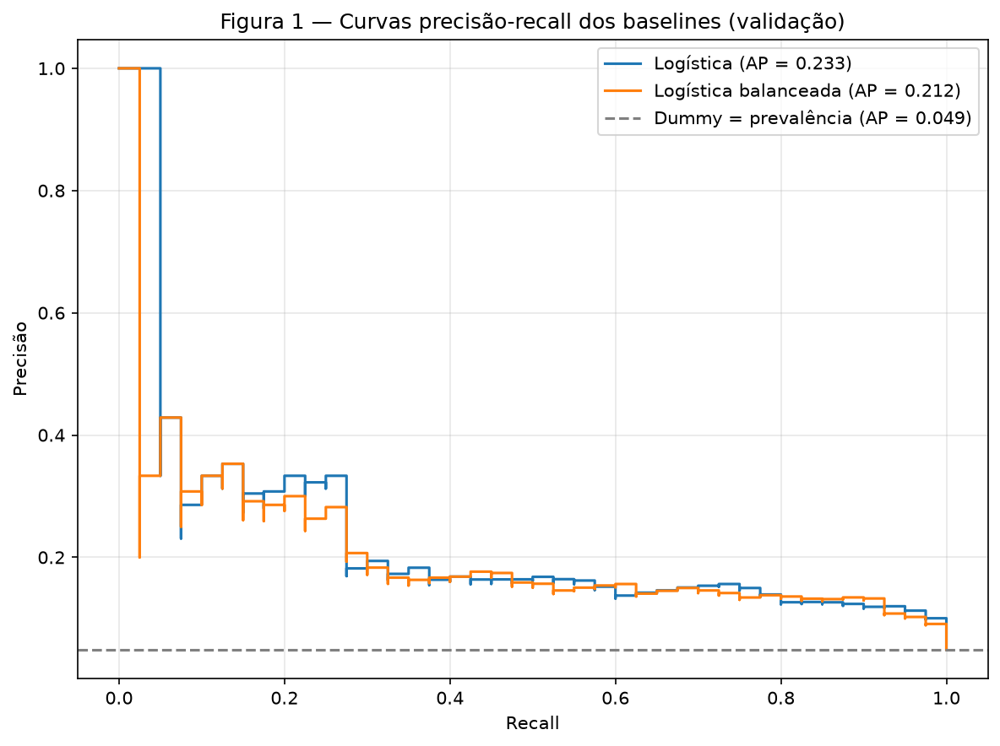
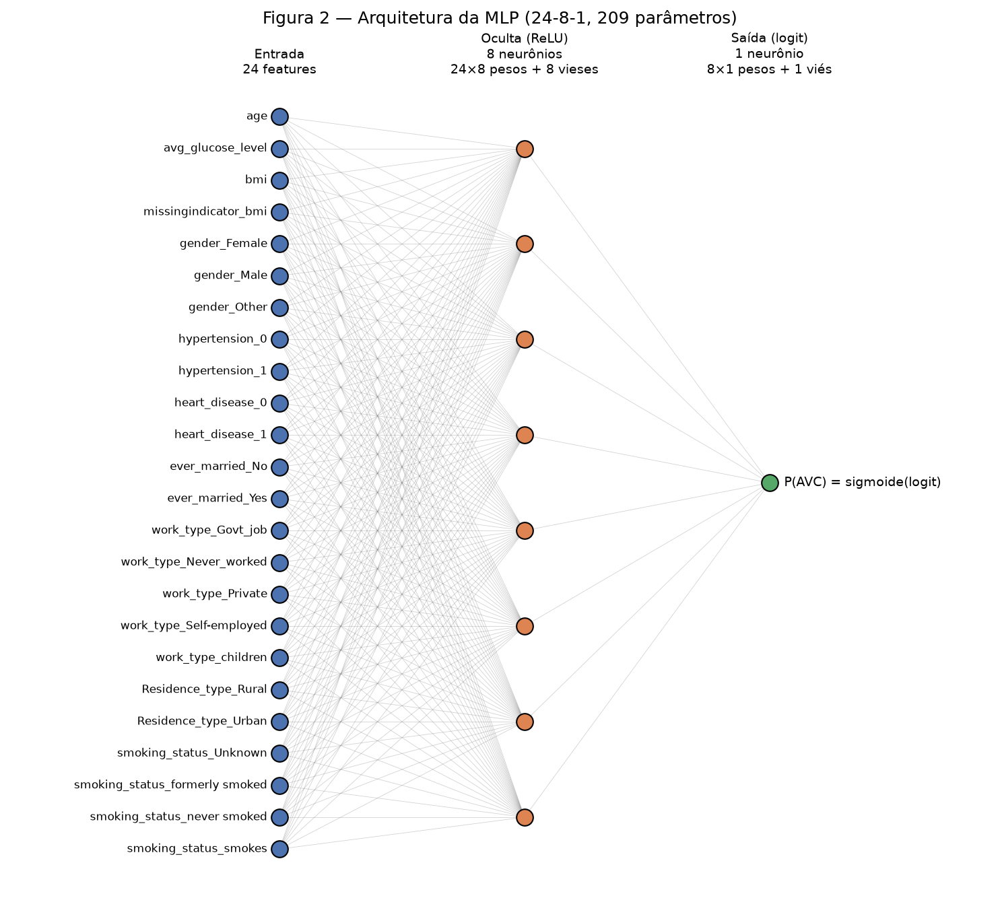
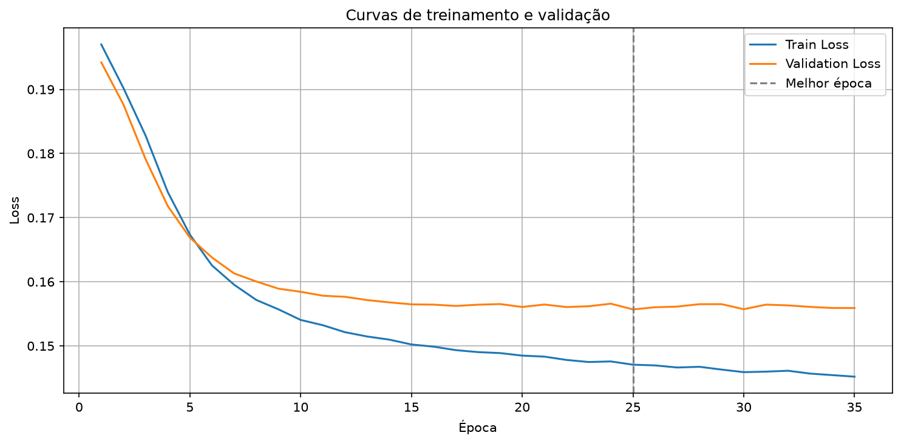
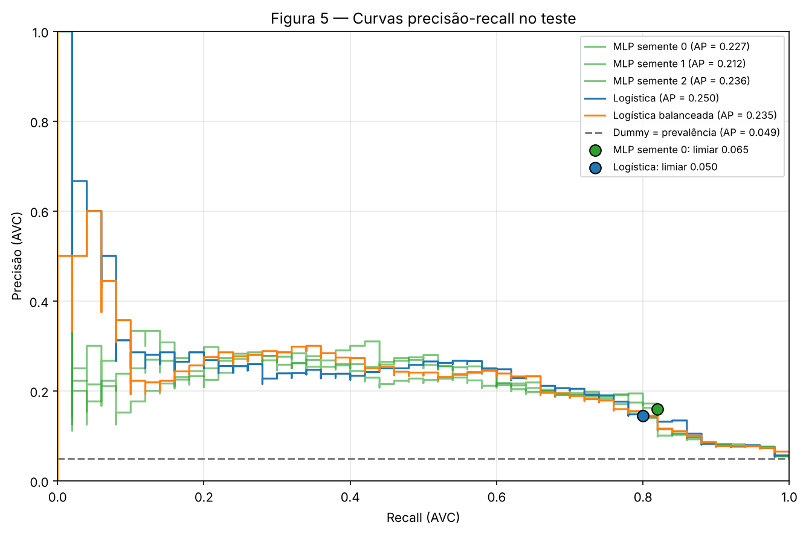
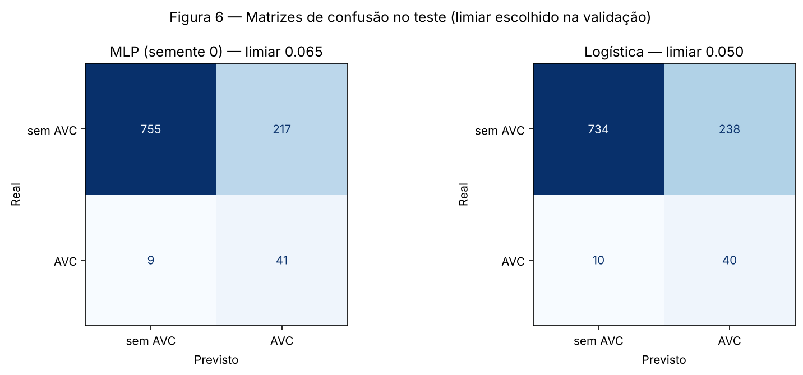
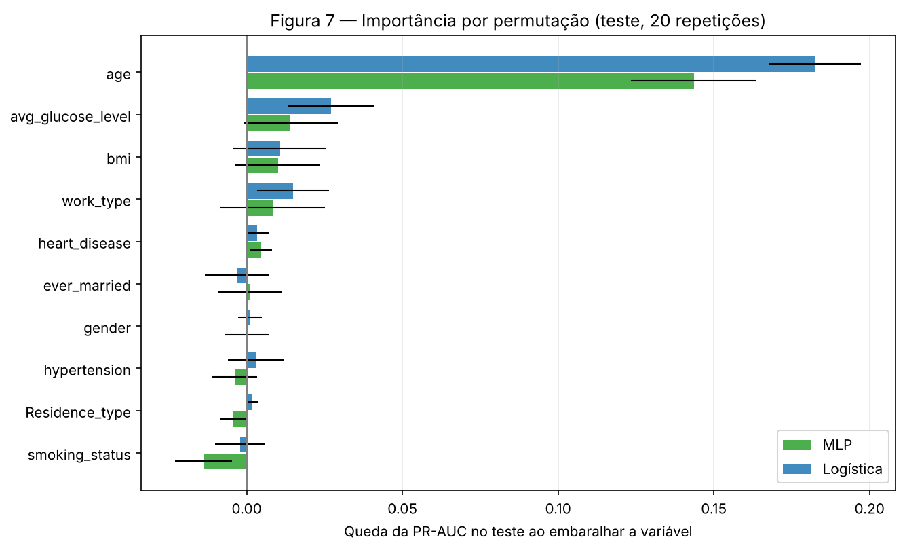

# 2. Classificação — previsão de AVC

!!! info "Equipe"

    | Nome completo | GitHub |
    |---------------|--------|
    | Iara Vivian | [iaravsp](https://github.com/iaravsp) |
    | Vinicius Miranda | [Iamiran1](https://github.com/Iamiran1) |

    Dataset, decisões e análise exploratória: [EDA](../eda/index.md).

**Pergunta da entrega:** uma rede neural aprende, sobre o *Stroke Prediction Dataset*, algo que modelos mais simples não aprendem? E quanto dá para confiar no número que ela entrega?

**Resposta curta:** não. A MLP empatou com a Regressão Logística (PR-AUC no teste de 0,225 ± 0,012 contra 0,250, com o intervalo de confiança da diferença passando por zero) e não atingiu o critério de sucesso. As análises mostram que o limite está na informação das variáveis, dominada pela idade, e não na capacidade do modelo.

Todo o código está em [`code/`](#reprodutibilidade): o notebook [`supervised_learning.ipynb`](code/supervised_learning.ipynb), a mesma análise em script (`supervised_learning.py`) e a rede e o loop de treino (`mlp.py`).

---

## 0. Ponto de partida

**Pipeline do EDA.** O pré-processamento é o do EDA, importado de `docs/projects/eda/code/preprocessing.py` (`build_preprocessor`): imputação pela mediana e `RobustScaler` nas 3 numéricas, indicador de IMC ausente e *one-hot* nas 7 categóricas, totalizando **24 colunas**. Ele é ajustado **somente no treino**; validação e teste passam apenas por `transform`. Não houve correções apontadas na avaliação do EDA, então o pipeline foi reaproveitado sem alterações.

**Divisão.** A mesma do EDA: 80/20 estratificada por `stroke`, `random_state=42`. A validação sai do treino, com outros 20% estratificados e a mesma semente.

| Conjunto | Pacientes | Casos de AVC | AVC (%) |
|---|---:|---:|---:|
| Treino | 3.270 | 159 | 4,86 |
| Validação | 818 | 40 | 4,89 |
| Teste | 1.022 | 50 | 4,89 |

**Métrica principal: PR-AUC** (*average precision*). Com 4,9% de AVC, a acurácia não serve: o Dummy, que nunca prevê AVC, tem 95,1% de acurácia e recall 0. A ROC-AUC também engana neste problema: na validação, a Regressão Logística tem ROC-AUC de **0,846**, mas PR-AUC de só **0,233**. A ROC-AUC divide os alarmes falsos pelos 778 negativos, e muitos alarmes ainda parecem uma taxa pequena; a precisão os compara com os 40 casos reais. O piso da PR-AUC é a prevalência (0,049).

**Prioridade ao recall.** Deixar passar um AVC custa mais do que um alarme falso. Por isso o limiar de decisão é escolhido na validação como **o maior limiar que mantém o recall de AVC em pelo menos 0,80**, e recall, precisão e matriz de confusão são relatados nesse limiar. A PR-AUC, que não depende do limiar, é a métrica usada para comparar e escolher modelos.

**Critério de sucesso (definido antes de treinar a rede):** a MLP é bem-sucedida se sua PR-AUC no teste, em média de 3 sementes, for **pelo menos 10% maior que a da melhor Regressão Logística no teste**. A meta de 10% leva em conta que o teste tem só 50 casos de AVC, o que faz a PR-AUC variar alguns pontos entre divisões.

---

## 1. Baselines

Os três baselines usam o mesmo `Pipeline` (pré-processamento do EDA + classificador), ajustado no treino e avaliado na validação.

**Tabela 1 — Baselines na validação.**

| Modelo | PR-AUC | ROC-AUC | Observação |
|---|---:|---:|---|
| Dummy (classe majoritária) | 0,049 | 0,500 | Acurácia 95,1%, recall 0 |
| Regressão Logística | 0,233 | 0,846 | No limiar 0,5: marca 3 pacientes, acerta 2 dos 40 casos |
| Regressão Logística balanceada | 0,212 | 0,842 | `class_weight="balanced"` |



**Figura 1 —** Curvas precisão-recall dos baselines na validação. O Dummy dá a mesma nota a todos os pacientes e aparece como a linha da prevalência.

O Dummy fixa o piso e confirma que a acurácia não serve como métrica. A Regressão Logística ordena bem os pacientes (ROC-AUC 0,846), mas no limiar padrão de 0,5 quase nunca prevê AVC: suas notas ficam perto da frequência real, em média 0,046.

**Por que balancear a Logística não melhorou a PR-AUC.** A versão balanceada multiplica o erro de cada paciente com AVC por ≈ 10,3 e o de cada paciente sem AVC por ≈ 0,53, como se o treino tivesse 50% de AVC. No treino, o intercepto é ajustado até que a média ponderada de (nota − rótulo) seja zero, ou seja, até a nota média coincidir com a frequência de AVC que o modelo enxerga. Por isso ele sobe de −3,83 para −0,25 e as notas sobem em bloco, sem que a ordem dos pacientes mude:

**Tabela 2 — Logística comum × balanceada (validação, exceto o intercepto).**

| | Comum | Balanceada |
|---|---:|---:|
| Intercepto *b* (treino) | −3,83 | −0,25 |
| Nota média | 0,046 | 0,312 |
| PR-AUC | 0,233 | 0,212 |
| Limiar 0,5: marcados / casos pegos | 3 / 2 | 223 / 30 |
| Limiar 0,05: marcados / casos pegos | 230 / 32 | — |

A balanceada no limiar 0,5 equivale à comum no limiar 0,05. Em um modelo linear, ponderar as classes equivale a mover o limiar e não acrescenta capacidade de separar os casos. A diferença de PR-AUC entre as duas (0,233 contra 0,212) é pequena e, com só 40 casos de AVC na validação, está dentro da variação esperada entre divisões.

O baseline opcional (random forest ou boosting) não foi feito. O enunciado avisa que, em dados tabulares, os baselines costumam empatar com a rede, e foi o que aconteceu aqui (etapa 5).

---

## 2. A rede

**Arquitetura.** MLP em PyTorch com uma camada oculta: **24 entradas → 8 neurônios (ReLU) → 1 logit**.



**Figura 2 —** Grafo da MLP 24-8-1, com os nomes das 24 colunas que saem do pipeline do EDA.

**Saída e perda.** A saída é um único logit, e a perda é a `BCEWithLogitsLoss` (entropia cruzada binária), o par correto para classificação binária. A sigmoide fica dentro da perda, o que evita calcular log de probabilidades extremas e torna a conta numericamente estável. Na previsão, `sigmoide(logit)` dá a probabilidade de AVC.

**Camadas.** O teorema da aproximação universal garante que uma camada oculta com ativação não linear é suficiente em princípio, mas não diz quantos neurônios usar. Uma camada é a menor rede que já é não linear, um passo acima da Regressão Logística; sem ela, a rede seria uma Logística.

**Largura.** Escolhida pela validação, antes de definir a rede, entre 8, 16 e 32 neurônios (AdamW, taxa 0,001, parada antecipada, 5 sementes).

**Tabela 3 — Escolha da largura (validação, 5 sementes).**

| Arquitetura | Parâmetros | Parâmetros por caso de AVC | PR-AUC | Melhor época |
|---|---:|---:|---:|---:|
| 24-8-1 | 209 | 1,31 | 0,225 ± 0,008 | 28,8 |
| 24-16-1 | 417 | 2,62 | 0,212 ± 0,009 | 17,8 |
| 24-32-1 | 833 | 5,24 | 0,207 ± 0,008 | 14,2 |

Com mais neurônios, a melhor época chega mais cedo e a PR-AUC cai, sinal de que redes maiores passam a memorizar os 159 casos de AVC do treino. A largura 8 foi a escolhida. As diferenças são de 1 a 2 desvios: uma tendência, não uma separação forte.

**Ativação: ReLU.** Sem ativação não linear, duas camadas se reduzem a uma (`V(Wx) = (VW)x`). A ReLU (`max(0, x)`) treina rápido e não sofre de gradiente desvanecente onde o neurônio está ativo (derivada 1, enquanto a da sigmoide nunca passa de 0,25).

**Inicialização.** Os pesos usam a inicialização padrão do PyTorch (uniforme em ±1/√n_entradas, uma variante de Kaiming): o sorteio quebra a simetria entre os neurônios, que de outro modo receberiam os mesmos gradientes e continuariam iguais, e mantém uma escala adequada para uma rede rasa. O **viés da saída** começa no log-odds da prevalência do treino, log(0,0486 / 0,9514) ≈ **−2,97**. Ele é somado igualmente à nota de todos os pacientes, como o intercepto da Logística. Com o sorteio padrão, a rede começaria prevendo cerca de 50% de AVC para todos; com −2,97, ela começa em ≈ 5%:

**Tabela 4 — Viés inicial da saída (rede 24-8-1, validação, 5 sementes).**

| Viés inicial | P(AVC) média antes do treino | Perda inicial | Melhor época | PR-AUC |
|---|---:|---:|---:|---:|
| Padrão do PyTorch | 0,534 | 0,763 | 28,8 | 0,225 ± 0,008 |
| Log-odds (−2,97) | 0,050 | 0,196 | 26,4 | 0,222 ± 0,015 |

O efeito fica no início do treino: a PR-AUC não muda além do ruído. A escolha foi mantida por coerência com o desbalanceamento e com o comportamento do intercepto visto na Logística.

**Parâmetros × linhas do treino.**

| | Parâmetros | Linhas de treino | Parâmetros por linha | Linhas por parâmetro | Parâmetros por caso de AVC |
|---|---:|---:|---:|---:|---:|
| Regressão Logística | 25 | 3.270 | 0,01 | 130,8 | 0,16 |
| MLP 24-8-1 | 209 | 3.270 | 0,06 | 15,7 | 1,31 |

Pelo total de linhas, a rede é pequena (≈ 16 linhas por parâmetro). O número que a limita, porém, é o de casos de AVC: são só 159, e a rede já tem mais parâmetros do que casos. Esse limite explica o resultado do teste de largura e motiva a regularização da etapa 4.

**Código.** A rede e o loop de treino estão em `code/mlp.py`: `construir_mlp` monta a MLP (com dropout e BatchNorm opcionais, usados na etapa 4) e `treinar_mlp` treina com AdamW e parada antecipada.

??? example "`code/mlp.py`"

    ```python
    --8<-- "docs/projects/classification/code/mlp.py"
    ```

---

## 3. Treinamento

**Otimizador: AdamW.** O Adam mantém, para cada parâmetro, uma média dos gradientes recentes (momentum) e uma média dos seus quadrados, e com isso dá a cada peso um passo próprio. Isso ajuda aqui: os gradientes vindos dos casos de AVC são poucos e ruidosos, e colunas *one-hot* raras (como `gender_Other` ou `work_type_Never_worked`) quase nunca recebem gradiente. O Adam também funciona bem com a taxa padrão, sem busca extensa. A variante AdamW aplica o weight decay diretamente nos pesos, separado da adaptação do passo; no Adam original o decay é distorcido por ela, e isso importa porque o weight decay é testado na etapa 4.

**Taxa, batch e épocas.**

- **Taxa:** 0,001 (padrão do Adam) na rede base das etapas 2 e 3. A busca da etapa 4 escolheu **0,003** para a rede final, que converge mais rápido sem perder desempenho.
- **Batch:** 32 pacientes, ≈ 103 atualizações por época. O mini-batch dá muitas atualizações por época e um ruído no gradiente que ajuda a não ficar preso em pontos ruins.
- **Épocas:** teto de 100; quem decide a parada é a validação.

**Parada antecipada.** A cada época mede-se a perda na validação; o treino para depois de 10 épocas sem melhora (paciência 10) e **restaura os pesos da melhor época**. Na rede base, a melhor perda de validação (0,1557) ocorreu na época 25 e o treino parou na época 35.



**Figura 3 —** Curvas de perda (entropia cruzada) no treino e na validação por época, rede base (taxa 0,001); a linha tracejada marca a melhor época.

**Leitura das curvas.** A rede converge rápido: a perda de validação cai de 0,194 para 0,158 nas 10 primeiras épocas e depois fica praticamente estável, com o mínimo de 0,1557 na época 25. A perda de treino continua caindo até o fim (0,147 na época 25, 0,145 na 35). É nesse ponto que começa o overfitting: a partir de ≈ 20 a 25 épocas, o treino melhora sem que a validação acompanhe. O diagnóstico da etapa 4 confirma, deixando a rede treinar 100 épocas sem parar: a PR-AUC de treino sobe para 0,354 e a de validação cai para 0,211.

**O limiar 0,5 não serve.** Na rede base, nenhuma probabilidade de validação passa de 0,38, e no limiar 0,5 a rede não prevê nenhum AVC (recall 0), embora sua PR-AUC seja 0,234 e a ROC-AUC 0,842. As notas acompanham a frequência real de AVC (média 0,049); com limiar 0,05, o recall na validação sobe para 0,85, com precisão de 0,13. Por isso o limiar é escolhido pela regra da etapa 0.

**Tratamento do desbalanceamento.** O EDA deixou o SMOTENC pronto e prometeu compará-lo com pesos na perda. A comparação usa a rede base, 5 sementes, e a parada antecipada pela PR-AUC de validação:

**Tabela 5 — Tratamento do desbalanceamento (validação, 5 sementes).**

| Tratamento | Exemplos de treino | PR-AUC | Melhor época |
|---|---:|---:|---:|
| Nenhum | 3.270 | **0,232 ± 0,013** | 30,0 |
| `pos_weight` = 19,57 | 3.270 | 0,224 ± 0,020 | 35,0 |
| SMOTENC | 6.222 | 0,152 ± 0,013 | 10,8 |

**Decisão: a rede é treinada sem balanceamento.** O `pos_weight` age como na Logística balanceada: infla as notas, mas não melhora a ordenação, e o mesmo efeito se obtém escolhendo o limiar. O SMOTENC piora de verdade: ele cria 2.952 casos sintéticos a partir de 159 reais, e cerca de 95% dos exemplos de AVC vistos pela rede passam a ser interpolações (risco que o EDA já apontava).

---

## 4. Regularização e hiperparâmetros

Todas as comparações usam a mesma divisão, as mesmas 5 sementes, a parada antecipada pela perda de validação e apenas a validação; o teste fica reservado para a etapa 5. O código está em `code/mlp.py`.

**Diagnóstico: overfitting ou underfitting?** A rede base é treinada por 100 épocas sem parar, e treino e validação são lidos juntos.

**Tabela 6 — Diagnóstico da rede base (média de 5 sementes).**

| | PR-AUC treino | PR-AUC validação | Distância |
|---|---:|---:|---:|
| Na melhor época (média 22) | 0,259 | 0,220 | 0,039 |
| Na última época (100) | 0,354 | 0,211 | 0,143 |

Sem parada antecipada há overfitting: o treino continua melhorando e a validação piora. Na melhor época, os dois ficam próximos, então a parada antecipada já contém a maior parte da memorização. Não é underfitting por falta de capacidade: a rede chega a 0,354 no treino, e redes mais largas pioraram a validação (etapa 2). A regularização deve atacar o overfitting, sem aumentar a rede.

**Técnicas comparadas com a rede sem regularização** (taxa 0,001):

- **Weight decay** (0,01 e 0,1, a faixa que a aula indica para AdamW): encolhe os pesos a cada passo; memorizar exige pesos grandes. Vieses e parâmetros da BatchNorm ficam fora da penalidade.
- **Dropout** (0,1 e 0,2): desliga neurônios ao acaso no treino, impedindo co-adaptações. Os valores são baixos porque a rede tem só 8 neurônios; dropout alto destrói uma rede pequena.
- **BatchNorm**: padroniza a saída da camada oculta com as estatísticas do mini-batch. Ordem: Linear → BatchNorm → ReLU → Dropout.

**Tabela 7 — Técnicas de regularização (validação, 5 sementes).**

| Configuração | PR-AUC validação | Desvio | PR-AUC treino | Distância | Melhor época |
|---|---:|---:|---:|---:|---:|
| Sem regularização | 0,220 | 0,014 | 0,259 | 0,039 | 21,8 |
| Weight decay 0,01 | 0,219 | 0,016 | 0,259 | 0,040 | 22,0 |
| Weight decay 0,1 | 0,219 | 0,017 | 0,260 | 0,041 | 26,0 |
| Dropout 0,1 | 0,218 | 0,011 | 0,261 | 0,043 | 25,2 |
| Dropout 0,2 | 0,219 | 0,017 | 0,257 | 0,038 | 32,6 |
| BatchNorm | 0,233 | 0,016 | 0,305 | 0,072 | 18,4 |

Weight decay e dropout praticamente não alteraram o resultado: todas as variações ficaram dentro do ruído entre sementes. Isso é esperado, porque a parada antecipada já interrompe o treino antes de a rede começar a decorar, e sobra pouco para regularizar. No caso do dropout, há mais um motivo: ele funciona melhor em redes com capacidade de sobra, o que não é o caso de uma camada com 8 neurônios. A BatchNorm foi a única técnica com efeito visível, um ganho de 0,013 na validação, cerca de 1 desvio. Esse ganho, porém, veio junto com uma PR-AUC de treino mais alta e uma distância maior entre treino e validação. Ou seja, a BatchNorm não regularizou a rede: ela a ajudou a se ajustar melhor aos dados, que é o papel principal da normalização.

**Busca de hiperparâmetros.** Taxa {0,001; 0,003} × dropout {0; 0,2} × weight decay {0; 0,01} × BatchNorm {não; sim} = 16 configurações, 5 sementes cada.

**Regra de escolha, definida antes de rodar a busca:** fica a configuração de maior PR-AUC média; se outras ficarem a menos de 1 desvio dela, escolhe-se entre essas a que usa menos técnicas de regularização e, em empate, a de menor desvio. Com só 40 casos de AVC na validação, a regra evita escolher o vencedor pelo ruído.

**Tabela 8 — Busca de hiperparâmetros, ordenada pela PR-AUC na validação.**

| # | Taxa | Dropout | Weight decay | BatchNorm | PR-AUC validação | Desvio | Distância | Melhor época | Técnicas |
|---:|---:|---:|---:|:---:|---:|---:|---:|---:|---:|
| 1 | 0,001 | 0 | 0,01 | sim | 0,2373 | 0,0212 | 0,072 | 19,8 | 2 |
| 2 | 0,003 | 0,2 | 0,01 | sim | 0,2363 | 0,0103 | 0,054 | 11,4 | 3 |
| 3 | 0,001 | 0,2 | 0,01 | sim | 0,2359 | 0,0141 | 0,054 | 20,6 | 3 |
| 4 | 0,003 | 0,2 | 0 | sim | 0,2350 | 0,0140 | 0,053 | 10,4 | 2 |
| 5 | 0,003 | 0 | 0 | sim | 0,2342 | 0,0159 | 0,064 | 8,6 | 1 |
| 6 | 0,001 | 0 | 0 | sim | 0,2327 | 0,0163 | 0,072 | 18,4 | 1 |
| 7 | 0,003 | 0 | 0,01 | sim | 0,2314 | 0,0170 | 0,073 | 9,4 | 2 |
| 8 | 0,001 | 0,2 | 0 | sim | 0,2299 | 0,0141 | 0,060 | 20,8 | 2 |
| 9 | 0,003 | 0,2 | 0,01 | não | 0,2290 | 0,0082 | 0,030 | 12,4 | 2 |
| 10 | 0,003 | 0,2 | 0 | não | 0,2288 | 0,0063 | 0,034 | 12,2 | 1 |
| **11** | **0,003** | **0** | **0** | **não** | **0,2282** | **0,0096** | **0,037** | **9,2** | **0** |
| 12 | 0,003 | 0 | 0,01 | não | 0,2240 | 0,0095 | 0,036 | 8,4 | 1 |
| 13 | 0,001 | 0 | 0 | não | 0,2205 | 0,0141 | 0,039 | 21,8 | 0 |
| 14 | 0,001 | 0,2 | 0 | não | 0,2192 | 0,0171 | 0,038 | 32,6 | 1 |
| 15 | 0,001 | 0 | 0,01 | não | 0,2191 | 0,0162 | 0,040 | 22,0 | 1 |
| 16 | 0,001 | 0,2 | 0,01 | não | 0,2177 | 0,0183 | 0,039 | 33,0 | 2 |

**Leitura e escolha.** As 8 primeiras configurações usam BatchNorm (0,230 a 0,237) e, dentro de cada taxa, toda configuração com BatchNorm supera as sem ela: um padrão consistente, mas pequeno. A taxa de 0,003 converge mais rápido (melhor época entre ≈ 8 e 12) sem perder desempenho. A melhor configuração obteve 0,237 ± 0,021; pela regra, as 16 ficam a menos de 1 desvio dela, e a mais simples é a **rede sem regularização com taxa 0,003** (0,228 ± 0,010, linha 11), que segue para a etapa 5. A diferença para a melhor (0,009) é menor que o desvio entre sementes. Os resultados com BatchNorm também variam ligeiramente de um computador para outro (as configurações sem ela se reproduzem exatamente), outro motivo para não depender dela.

**Conclusão da etapa:** com uma rede pequena e parada antecipada, a regularização explícita não trouxe ganho distinguível do ruído; a parada antecipada já cumpre esse papel.

---

## 5. Avaliação no teste

A configuração escolhida (24-8-1, AdamW com taxa 0,003, sem regularização) foi retreinada com **3 sementes** no mesmo treino e com a mesma parada antecipada. O limiar de cada modelo foi escolhido **na validação** pela regra da etapa 0 (recall ≥ 0,80) e então aplicado ao teste. Os baselines são os da etapa 1.

!!! note "Uso do teste"

    O teste foi usado **uma única vez**, nesta etapa, depois de todas as escolhas feitas na validação. Nada (arquitetura, regularização, tratamento do desbalanceamento, limiar ou referência do critério) foi escolhido a partir dele.

**Tabela 9 — Rede × baselines no teste (1.022 pacientes, 50 com AVC; limiar escolhido na validação).**

| Modelo | PR-AUC | ROC-AUC | Recall AVC | Precisão AVC | F1 AVC | Recall sem AVC | Precisão sem AVC | F1 sem AVC | F1 macro |
|---|---:|---:|---:|---:|---:|---:|---:|---:|---:|
| Dummy | 0,049 | 0,500 | 1,000 | 0,049 | 0,093 | 0,000 | 0,000 | 0,000 | 0,047 |
| Regressão Logística | **0,250** | 0,843 | 0,800 | 0,144 | 0,244 | 0,755 | 0,987 | 0,855 | 0,550 |
| Logística balanceada | 0,235 | 0,842 | 0,800 | 0,141 | 0,240 | 0,750 | 0,986 | 0,852 | 0,546 |
| MLP (média de 3 sementes) | 0,225 | 0,839 | 0,813 | 0,156 | 0,262 | 0,773 | 0,988 | 0,867 | 0,565 |
| MLP (desvio entre sementes) | 0,012 | 0,004 | 0,012 | 0,005 | 0,008 | 0,006 | 0,001 | 0,004 | 0,006 |

Por semente, a MLP teve PR-AUC de 0,227, 0,212 e 0,236, com limiares (escolhidos na validação) de 0,065, 0,060 e 0,070 e melhores épocas 8, 15 e 7.



**Figura 5 —** Curvas precisão-recall no teste. Os pontos marcam a posição de cada modelo no limiar escolhido na validação.



**Figura 6 —** Matrizes de confusão no teste, no limiar escolhido na validação: MLP (semente 0) e Regressão Logística.

**Leitura.** No resumo de todos os limiares, a rede ficou abaixo dos dois modelos lineares (PR-AUC 0,225 contra 0,250 e 0,235); na ROC-AUC os três praticamente empatam. No ponto de operação a ordem se inverte levemente: a rede atinge recall de 0,813 com precisão de 0,156 e F1 macro de 0,565, contra 0,800, 0,144 e 0,550 da Logística. A vantagem da Logística está no início da curva (recall abaixo de 0,1, Figura 5); perto de recall 0,80, onde o modelo opera, as curvas quase coincidem. O limiar escolhido na validação se manteve no teste: todos os modelos ficaram com recall entre 0,80 e 0,82.

**Critério de sucesso: não atingido.** A meta era 1,10 × 0,250 = **0,275**; a rede obteve **0,225 ± 0,012**, 0,025 abaixo da Logística, cerca de 2 desvios entre sementes. Mas a variação entre sementes não é a única incerteza: o teste tem só 50 casos de AVC. Um bootstrap pareado dos pacientes do teste (2.000 reamostragens) dá um **intervalo de 95% de [−0,068; +0,005]** para a diferença rede − Logística, e a rede foi melhor em 6% das reamostragens. A rede **não superou** a Logística e tende a ficar abaixo dela, mas o teste não tem tamanho para afirmar que ela é pior.

**Análise do recall.** Como definido na etapa 0, o recall de AVC é analisado à parte.

**Tabela 10 — Recall de AVC no teste, no limiar escolhido na validação.**

| Modelo | Limiar | Marcados | AVCs identificados | AVCs não detectados | Alarmes falsos | Recall | Precisão | Alarmes falsos por AVC identificado |
|---|---:|---:|---:|---:|---:|---:|---:|---:|
| Dummy | 0,000 | 1.022 | 50 | 0 | 972 | 1,000 | 0,049 | 19,4 |
| Regressão Logística | 0,050 | 278 | 40 | 10 | 238 | 0,800 | 0,144 | 5,95 |
| Logística balanceada | 0,485 | 283 | 40 | 10 | 243 | 0,800 | 0,141 | 6,08 |
| MLP (média de 3 sementes) | 0,065 | 261 | 40,7 | 9,3 | 220,3 | 0,813 | 0,156 | 5,42 |

Rede e Logísticas identificam 40 a 41 dos 50 AVCs e deixam passar 9 a 10. Na prática, cerca de 1 em cada 6 ou 7 pacientes marcados tem AVC, e 1 em cada 5 AVCs passa despercebido. A vantagem da rede no ponto de operação (≈ 18 alarmes falsos a menos e 1 caso a mais) é da ordem da variação entre as sementes (217 a 227 alarmes falsos).

---

## 6. Análise de erros

A análise usa as previsões da rede no teste da etapa 5 (3 sementes, cada uma no seu limiar). Nada aqui altera o modelo ou o limiar.

**Erro por subgrupo.** Os subgrupos vêm das variáveis que o EDA destacou. "Erro total" é a fração de pacientes do subgrupo classificados errado; os valores são médias das 3 sementes.

**Tabela 11 — Erro da rede por subgrupo no teste.**

| Variável | Subgrupo | Pacientes | AVC | AVC (%) | Recall AVC | AVCs não detectados | Taxa de alarme falso | Erro total |
|---|---|---:|---:|---:|---:|---:|---:|---:|
| Faixa etária | < 45 anos | 527 | 6 | 1,1 | 0,17 | 5,0 | 0,006 | 0,015 |
| | 45 a 64 anos | 295 | 9 | 3,1 | 0,52 | 4,3 | 0,219 | 0,227 |
| | **≥ 65 anos** | 200 | 35 | 17,5 | 1,00 | 0,0 | 0,937 | **0,773** |
| Hipertensão | não | 921 | 38 | 4,1 | 0,76 | 9,0 | 0,171 | 0,174 |
| | sim | 101 | 12 | 11,9 | 0,97 | 0,3 | 0,779 | 0,690 |
| Doença cardíaca | não | 967 | 39 | 4,0 | 0,76 | 9,3 | 0,204 | 0,205 |
| | sim | 55 | 11 | 20,0 | 1,00 | 0,0 | 0,712 | 0,570 |
| IMC | ausente | 31 | 3 | 9,7 | 1,00 | 0,0 | 0,631 | 0,570 |
| | informado | 991 | 47 | 4,7 | 0,80 | 9,3 | 0,215 | 0,214 |
| Glicose | > 169,5 (extremo pelo critério de 1,5 × IQR do EDA) | 122 | 18 | 14,8 | 1,00 | 0,0 | 0,673 | 0,574 |
| | dentro do limite | 900 | 32 | 3,6 | 0,71 | 9,3 | 0,173 | 0,177 |
| Tabagismo | Unknown | 297 | 9 | 3,0 | 0,56 | 4,0 | 0,074 | 0,085 |
| | formerly smoked | 171 | 14 | 8,2 | 0,91 | 1,3 | 0,476 | 0,444 |
| | never smoked | 391 | 19 | 4,9 | 0,89 | 2,0 | 0,229 | 0,223 |
| | smokes | 163 | 8 | 4,9 | 0,75 | 2,0 | 0,252 | 0,252 |

O erro se organiza quase todo pela idade. Abaixo de 45 anos, a rede quase não dá alarme falso, mas deixa passar 5 dos 6 AVCs (recall 0,17). Com 65 anos ou mais, identifica os 35 AVCs, mas marca 94% dos pacientes sem AVC dessa faixa: é o **subgrupo com o maior erro total (0,773)**. O mesmo padrão aparece nos fatores de risco (hipertensão, doença cardíaca, glicose extrema, IMC ausente): recall de 0,97 a 1,0 e alarme falso de 0,63 a 0,78. Os ≈ 9 AVCs perdidos estão todos em pacientes com menos de 65 anos, sem hipertensão, sem doença cardíaca e com glicose dentro do limite.

*Hipóteses.* (1) No limiar escolhido, a rede funciona na prática como uma regra de risco por idade e comorbidades: entre os pacientes de alto risco, a prevalência é alta (17,5% entre os idosos) e as 10 variáveis não trazem informação para separar quem teve AVC. (2) Os AVCs em jovens sem fatores de risco provavelmente têm causas que não estão no dataset. (3) O recall menor no tabagismo `Unknown` (0,56) é reflexo da idade: o EDA (Tabela 6A) mostrou que essa categoria concentra pacientes mais jovens.

**Piores exemplos.** Os erros de maior confiança, com a nota média das 3 sementes (limiar médio ≈ 0,065):

- **AVCs com as menores notas (0,001 a 0,028):** 8 pacientes de 14 a 58 anos, todos sem hipertensão, sem doença cardíaca e com glicose entre 58 e 98; um deles é uma paciente de 14 anos (`work_type = children`). *Hipótese:* são AVCs sem nenhum dos marcadores que a rede aprendeu; o caso de 14 anos lembra os registros extremos que o EDA já apontava (AVC aos 1,32 anos) e pode ser um caso raro ou um erro de registro.
- **Pacientes sem AVC com as maiores notas (0,29 a 0,35):** 8 pacientes de 61 a 82 anos, quase todos com doença cardíaca, hipertensão ou glicose acima de 200; **5 dos 8 não têm IMC registrado**. *Hipóteses:* são pacientes de alto risco sem AVC registrado (sem informação temporal, não se sabe se tiveram AVC depois da coleta); e a rede usa a ausência do IMC como sinal de risco, reproduzindo a associação do EDA (21,8% de AVC entre os sem IMC no treino), que pode vir do processo de coleta e não da saúde do paciente.

**Importância por permutação.** Cada uma das 10 variáveis originais é embaralhada entre os pacientes do teste (20 repetições) e mede-se a queda da PR-AUC. A permutação é feita antes do pré-processamento: cada categórica é embaralhada inteira, e o IMC leva junto o indicador de ausência. A Regressão Logística entra como comparação.

**Tabela 12 — Importância por permutação no teste (queda da PR-AUC, média ± desvio de 20 repetições).**

| Variável | MLP | Regressão Logística |
|---|---:|---:|
| `age` | **0,144 ± 0,020** | **0,183 ± 0,015** |
| `avg_glucose_level` | 0,014 ± 0,015 | 0,027 ± 0,014 |
| `bmi` (+ indicador de ausência) | 0,010 ± 0,014 | 0,011 ± 0,015 |
| `work_type` | 0,008 ± 0,017 | 0,015 ± 0,012 |
| `heart_disease` | 0,005 ± 0,004 | 0,003 ± 0,004 |
| `ever_married` | 0,001 ± 0,010 | −0,003 ± 0,010 |
| `gender` | 0,000 ± 0,007 | 0,001 ± 0,004 |
| `hypertension` | −0,004 ± 0,007 | 0,003 ± 0,009 |
| `Residence_type` | −0,004 ± 0,004 | 0,002 ± 0,002 |
| `smoking_status` | −0,014 ± 0,009 | −0,002 ± 0,008 |



**Figura 7 —** Importância por permutação no teste, MLP e Regressão Logística.

A idade domina, com queda uma ordem de grandeza acima de qualquer outra variável. Para as demais, o desvio é do tamanho da queda média, então a importância delas não se distingue com segurança de zero. O tabagismo tem queda negativa na rede (embaralhá-lo melhora ligeiramente o resultado), sinal de que ela aprendeu um pouco de ruído nessa variável. Rede e Logística dependem das mesmas variáveis, coerente com o empate entre as duas.

**Comparação com o EDA.** A permutação **confirma** o principal achado do EDA: a idade tem a maior diferença entre as classes (Tabela 7 do EDA), e glicose elevada e IMC ausente distinguiam subconjuntos com mais AVC. Ela **não confirma** hipertensão e doença cardíaca, que no EDA tinham proporções de AVC bem acima da média (Tabela 6 do EDA). A explicação mais provável é a sobreposição com a idade, já apontada no EDA como possível confundimento (Tabela 6A): esses pacientes são, em sua maioria, idosos, e com a idade disponível a hipertensão acrescenta pouca informação.

---

## 7. Conclusão

**A rede valeu a pena?** Como modelo de previsão, não. A MLP empatou com a Regressão Logística no teste e não atingiu o critério de sucesso; a pequena vantagem no ponto de operação é da ordem da variação entre sementes. Diante de um empate, a Logística é a escolha mais sensata: tem 25 parâmetros em vez de 209, é determinística, interpretável e suas probabilidades representam o risco observado. Como investigação, valeu: o projeto mostrou de forma consistente que o limite está nos dados. Aumentar a largura, regularizar, tratar o desbalanceamento ou mudar a inicialização não alterou a PR-AUC além do ruído, e os dois modelos dependem praticamente só da idade.

**Limitações.**

- **Poucos casos de AVC:** 249 no total, 40 na validação e 50 no teste; diferenças de 0,01 a 0,02 na PR-AUC não são confiáveis.
- **Uma única divisão de validação:** as escolhas das etapas 2 a 4 foram feitas numa só validação, e com tão poucos casos a variação entre divisões tende a ser grande.
- **Sem informação temporal:** não se sabe se as medidas foram coletadas antes do AVC, então o modelo não pode ser apresentado como previsão de um AVC futuro.
- **IMC ausente como sinal de risco:** a associação pode refletir o processo de coleta, não a saúde do paciente.
- **Variáveis limitadas:** faltam fatores clínicos conhecidos de AVC, como pressão arterial medida, colesterol e arritmias.
- **Origem dos dados:** o dataset é público e de fonte não documentada; não há garantia de que represente uma população real.

**Quem seria afetado por um erro.**

- **Falsos negativos (≈ 1 em cada 5 AVCs):** concentram-se em pacientes com menos de 65 anos e sem fatores de risco; abaixo de 45 anos, a rede detecta só 1 de 6 casos. É o erro mais grave, porque atrasa um atendimento urgente, e recai sobre quem parece de baixo risco.
- **Falsos positivos (≈ 220 dos 972 pacientes sem AVC):** concentram-se nos idosos (94% dos sem AVC com 65 anos ou mais são marcados), com custo de exames, ansiedade e uso de recursos.
- **Uso responsável:** um modelo assim só poderia servir como apoio de triagem, nunca como diagnóstico ou para negar atendimento. A decisão continua clínica, o desempenho deveria ser monitorado por faixa etária, e quem o usa precisa saber que ele quase nunca marca pacientes jovens.

**O que faríamos com mais tempo.** Repetir a seleção de modelo com validação cruzada estratificada; calibrar as probabilidades e avaliar limiares por faixa etária; buscar mais dados e variáveis clínicas, que é o que limita o desempenho; investigar a origem dos registros sem IMC; comparar com um modelo de boosting.

### Resumo dos resultados

| # | Resumo | Valor |
|---|---|---|
| 1 | Dataset, tarefa, alvo e métrica principal | Stroke Prediction Dataset (Kaggle); classificação binária; alvo `stroke`; PR-AUC |
| 2 | Treino · validação · teste (linhas) | 3.270 · 818 · 1.022 (159 · 40 · 50 casos de AVC) |
| 3 | Melhor baseline e sua métrica no teste | Regressão Logística: PR-AUC 0,250 (ROC-AUC 0,843) |
| 4 | Rede escolhida: camadas × unidades, nº de parâmetros, regularização | 1 camada oculta × 8 unidades (24-8-1, ReLU); 209 parâmetros; sem regularização explícita, só parada antecipada |
| 5 | Otimizador, taxa, batch e época em que parou | AdamW, taxa 0,003, batch 32, weight decay 0; melhores épocas 8, 15 e 7 (sementes 0, 1 e 2), parada após 10 épocas sem melhora |
| 6 | Métrica principal da rede no teste (média ± desvio, 3 sementes) | PR-AUC 0,225 ± 0,012 |
| 7 | Critério de sucesso atingido? | Não: meta 0,275 (Logística + 10%); diferença −0,025, IC 95% [−0,068; +0,005] |
| 8 | Subgrupo com o maior erro e o valor | Pacientes com 65 anos ou mais: erro total 0,773 (94% de alarme falso); o pior recall é abaixo de 45 anos (0,17) |

---

## Reprodutibilidade

| Arquivo | Conteúdo |
|---|---|
| `code/supervised_learning.ipynb` | Notebook com todas as etapas, tabelas e figuras |
| `code/supervised_learning.py` | A mesma análise em script, gerado a partir do notebook |
| `code/mlp.py` | Rede (`construir_mlp`) e loop de treino com parada antecipada (`treinar_mlp`) |
| `docs/projects/eda/code/preprocessing.py` | Pré-processamento do EDA, reaproveitado sem alterações |

Para reproduzir a partir de um clone limpo, na raiz do repositório:

```bash
pip install -r requirements-classificacao.txt
python docs/projects/classification/code/supervised_learning.py
```

O script imprime as tabelas e salva as figuras em `docs/projects/classification/figures/` (cerca de 7 minutos em CPU). As sementes são fixas (`random_state=42` nas divisões; sementes 0 a 4 nas comparações e 0 a 2 no teste). As configurações sem BatchNorm se reproduzem exatamente entre computadores; as com BatchNorm variam ligeiramente.

## Referências

- Material da disciplina: aulas de MLP, Otimização, Regularização e Métricas de classificação ([ANN-DL](https://insper.github.io/ann-dl/){:target='_blank'}).
- fedesoriano. [Stroke Prediction Dataset](https://www.kaggle.com/datasets/fedesoriano/stroke-prediction-dataset){:target='_blank'}. Kaggle.
